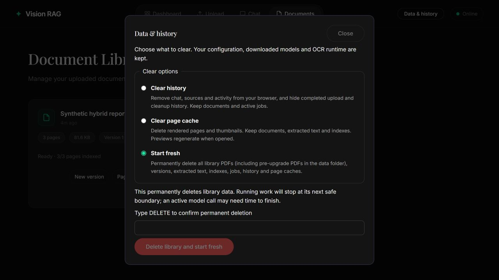

# Data controls and UI fixes

Added 2026-11-03. The original README and user research files are unchanged.

Restart the server and refresh the browser. Open **Data & history** in the header.
This implementation does not automatically clear the user's library.

## Options

| Option | Clears | Keeps |
| --- | --- | --- |
| Clear history | Saved conversations/messages/events, draft comparisons and browser activity/counters; completed upload/cleanup history is hidden | Saved findings, PDFs, versions, indexes, extracted text, active jobs |
| Clear page cache | Derived rendered pages, thumbnails and token artifacts in the managed artifacts directory | PDFs, indexes, text, jobs, saved conversations and findings |
| Start fresh | Managed originals, pre-upgrade PDFs/staging uploads, artifacts, extracted text/chunks, vectors, versions, jobs, conversations and findings | Configuration, API credentials, downloaded models, OCR runtime, unrelated files |

Phase 5 follow-up: Clear history also removes the workspace's persisted
conversations, questions, answers, viewer positions and stream events. Start
fresh removes those records too, together with Phase 4 retrieval revisions.
Cache clearing preserves saved conversations. Active answers check cancellation
at their next safe boundary; a provider/GPU call may finish before cleanup can
release the existing evidence-reader lock.

Phase 6 follow-up: Clear history removes draft comparisons but **keeps saved
findings**, including saved chat answers. Start fresh deletes all findings.
Mixed-workspace reset protection also checks conversation/finding records.
Unavailable-source findings can be removed from Findings; exporting them is
blocked until their sources are accessible again.

Start fresh requires selecting the option and typing **DELETE**. The action is
permanent. Clear history keeps the internal job records required for document
state and retries; Start fresh removes those records too. Clearing history/reset
notifies other open tabs of this app to clear their browser history and reload.
Clear page cache keeps the current chat open; previews regenerate on demand.

## Reset behavior

- The verified reset profile is one local library/workspace with local or memory
  Qdrant. Server Qdrant and libraries containing other workspaces are rejected
  before deletion. This is not a shared-deployment administration feature.
- A durable SQLite reset marker hides evidence and prevents new work while
  cleanup runs. Active ingestion stops at its next safe boundary; an in-flight
  encoder/OCR call may finish first. The existing query lock protects active
  evidence readers.
- Upload requests carry the library generation captured before their bodies are
  read. Requests admitted before a reset cannot recreate documents afterward.
  The initiating browser also aborts its pending uploads.
- Reset uses Qdrant's point deletion API and verifies zero points. It keeps the
  collection open because deleting/recreating local collection directories can
  retain old SQLite files under Windows locks. No direct deletion of live Qdrant
  or SQLite directories is performed.
- File cleanup stays inside the resolved configured library directory. Managed
  artifact/original/incoming directories and root `.pdf`/`.upload` files are
  removed. Unknown files are preserved. Old legacy PDFs are removed so automatic
  import cannot repopulate the reset library.
- If reset fails partway, evidence stays hidden and the reset marker persists.
  Retry Start fresh to finish. Startup also attempts recovery; if it still fails,
  the UI remains available for retry and processing stays disabled.
- Metadata schema 3 adds workspace-scoped control state. Source records are
  deleted in dependency order and SQLite is vacuumed. This is application data
  deletion, not a forensic secure-erasure guarantee.
- A new upload works after a successful reset; no server restart is needed for
  subsequent ordinary use.

## API

`GET /api/v1/maintenance` reports reset pending/running/supported state.

`POST /api/v1/maintenance` accepts:

```json
{"action":"history","confirmation":"CLEAR"}
```

Actions are `history`, `cache`, and `reset`. Reset requires
`"confirmation":"DELETE"`. Successful completion returns HTTP 200. Invalid
confirmation returns 422; conflicting/unsupported maintenance returns 409;
cleanup failures return 503 and can be retried. Cross-origin browser requests are
rejected. These routes do not add authentication to the existing local app.

## Styling and asset freshness

New version, Page processing, Cancel, and Retry use consistent dark rounded
buttons with hover/focus states. Document actions remain visible for keyboard
and touch access. Dialogs are centered and retain an accessible close control.
The HTML response embeds content hashes in stylesheet/script URLs; HTML and API
responses use `Cache-Control: no-store`, so future updates do not mix current
JavaScript with an older cached stylesheet.

## Validation

The final full regression suite passed: **87 tests**, with two upstream
deprecation warnings. Ruff, strict mypy (24 source files), Python compilation,
JavaScript syntax, and Git whitespace checks passed.
Storage checks use actual SQLite, persistent Qdrant, generated PDFs, concurrent
inference/reset, restart recovery, and deletion followed by a new upload. API
checks cover history filtering, active-job preservation, confirmation, origin
checks, empty post-reset state, and asset hashes. No user data is deleted by tests.

Browser review used the computer-use skill against an isolated fixture with fake
inference and actual local storage. It verified styled actions, the three clear
options, centered layout, and disabled/enabled reset controls before/after typing
DELETE. The permanent reset button was not submitted during browser review;
reset execution is verified by API and disk integration tests.


