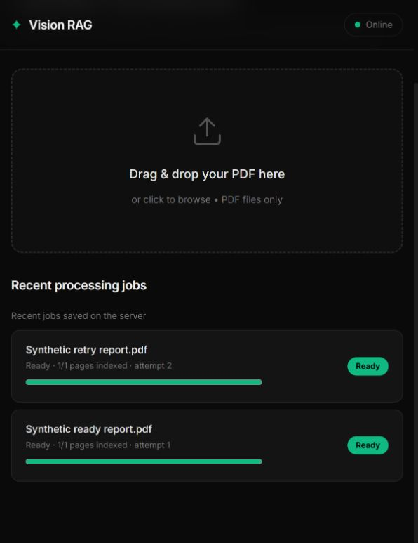

# Phase 2 — durable library and ingestion jobs

Phase 2 is implemented. This is its historical guide; see [Phase 3 guide](Phase%203%20guide.md) for the current ingestion workflow. The original README is unchanged.

## What works now

- SQLite records documents, immutable source versions, page artifacts, index builds,
  jobs and legacy imports.
- Originals use generated storage keys. Filenames remain display metadata.
- Same-content uploads in the configured workspace return the existing version/job.
  Different bytes with an existing filename require an explicit version upload.
- A single background worker processes a durable queue, with real stage/page progress,
  retry, cancellation and restart recovery.
- Local Qdrant persists on disk. Stable build/page point IDs prevent retry duplicates.
- Search receives only ready build IDs for the active document versions and the
  configured workspace/profile.
- Replacement publishes only after all expected points exist. Failed replacement
  leaves the previous ready version active. Retrying an older version does not
  silently roll back a newer active version.
- Source pages and original downloads resolve through immutable version IDs.
- Deletion hides a document immediately and queues retryable vector/file cleanup.
- The UI reads server-backed jobs, polls progress, and offers Retry, Cancel and
  New version controls. It distinguishes saved uploads from finished indexing.

## Run the upgrade

Stop the existing server with Ctrl+C, then run one instance from the project root:

```powershell
.\.venv\Scripts\python.exe -m vision_rag.api.main
```

Open [Vision](http://localhost:8000). Do not start a second instance on port 8000.
No new dependencies were required. Use the existing CUDA environment; see
[GPU setup](GPU%20setup.md) before running environment sync commands.

The verified default is QDRANT_MODE=local. Set these in .env if you want to make
the defaults explicit; keep your existing credentials and model settings:

```env
QDRANT_MODE=local
WORKSPACE_ID=local
INGESTION_WORKER_ENABLED=true
IMPORT_LEGACY_PDFS=true
```

QDRANT_IN_MEMORY is accepted so old .env files still load, but no longer selects
storage. Use QDRANT_MODE explicitly: local persists under DATA_DIR/qdrant;
memory is disposable/test-only; server uses the inherited host/port adapter.
Server/shared operation was not validated in this phase.

MODEL_WARMUP initializes the embedding pipeline, not the Gemini provider.
Ingestion does not require a Gemini key. Answer generation still requires a valid
key and available provider model. Your previously configured one-page CUDA batch
was preserved.

## Existing PDFs

On startup, root-level PDFs under DATA_DIR are validated, copied to generated keys,
recorded once and queued for indexing. Old vectors are not trusted because they
lack durable version/build identities. The new collection uses the configured
collection prefix plus _pooled_v1.

Legacy PDFs are preserved as pre-upgrade copies. A migration ledger prevents them
from resurrecting deleted documents on later restarts. Changes to already-imported
legacy paths must be uploaded explicitly; they are not silently treated as versions.
Unknown old .upload remnants are left untouched. Invalid/conflicting legacy files
remain on disk and are reported in server logs, rather than displayed as indexed.

This migration was tested with synthetic legacy PDFs. Your actual PDFs were not
migrated or reindexed during implementation; migration will run when you restart
the application using the new code.

## Durable layout

```text
data/
  metadata.sqlite3          authoritative metadata and queue
  metadata.sqlite3-wal      SQLite recovery files, when present
  .library.lock            one local application owner
  originals/<uuid>.pdf     immutable managed originals
  incoming/<uuid>.part     bounded upload staging
  artifacts/<sha256>/      cached page renditions and thumbnails
  qdrant/                  persistent local vector storage
```

Use a dedicated DATA_DIR for each independent local library. WORKSPACE_ID is a
server-configured scope; it is not authentication or a multi-user security boundary.

## API workflow

PowerShell 7 example:

```powershell
$job = Invoke-RestMethod -Method Post -Uri 'http://localhost:8000/api/v1/ingest' -Form @{ file = Get-Item '.\report.pdf' }
$job | Select-Object id, document_id, version_id, state, total_pages
Invoke-RestMethod "http://localhost:8000/api/v1/jobs/$($job.id)"
```

An accepted upload returns HTTP 202 with a typed job response. Its initial state
may already have advanced if the worker has claimed it. Do not interpret HTTP 202
as successful indexing.

| Method | Route | Behavior |
| --- | --- | --- |
| POST | /api/v1/ingest | Validate/store original and queue ingestion |
| GET | /api/v1/jobs?limit=50 | Recent durable jobs; maximum limit 200 |
| GET | /api/v1/jobs/{id} | Stage, pages indexed, attempts, errors, cancel request |
| POST | /api/v1/jobs/{id}/retry | Retry a failed/cancelled job |
| POST | /api/v1/jobs/{id}/cancel | Request cancellation of unfinished ingestion |
| GET | /api/v1/documents | Authoritative library state, not disk inventory |
| POST | /api/v1/documents/{id}/versions | Explicit immutable version upload |
| GET | /api/v1/documents/{id}/versions | Source versions and their state |
| GET | /api/v1/versions/{id}/pages/{page} | Resolve exact version/page; optional thumbnail=true |
| GET | /api/v1/versions/{id}/file | Stream managed original |
| DELETE | /api/v1/documents/{id} | Tombstone now; return cleanup job with HTTP 202 |
| GET | /api/v1/stats | Live documents, ready point count and unfinished job count |

The filename-based preview/deletion routes remain compatible with the current
library. New answer source records carry document_id, version_id and build_id.
Older browser answers without a version ID are marked as legacy; their previews
are not silently mapped to a different source version.

For replacement, the document ID stays fixed and the version ID changes. Identical
bytes return the existing historical version/job and do not reactivate an older
version. This phase does not expose rollback/activation controls.

## Consistency and recovery

1. Upload bytes are bounded, hashed, validated and fsynced before publication.
   An atomic rename publishes the managed original before metadata is committed.
2. SQLite creates version/build/job records in a short transaction.
3. The worker clears an incomplete build before retry, renders/embeds bounded
   batches, persists page records and upserts deterministic point IDs.
4. Only after the expected vector count is confirmed does one SQLite transaction
   publish the active version, ready build and ready job.
5. Interrupted jobs requeue at startup. Partial vectors remain hidden and are
   cleared before rebuilding. Generated orphan originals/staging files are reconciled.
6. Startup verifies ready source hashes and vector counts. Missing/corrupt sources
   or incomplete indexes become visible failures and stop being searchable.
7. Deletion tombstones first. Failed cleanup stays hidden and can be retried from
   the job list. Managed originals, vectors and unshared cached artifacts are removed.

SQLite, Qdrant and the filesystem do not participate in one transaction. Publication
gates, deterministic identities, tombstones and reconciliation are the consistency
strategy. The abrupt-exit test exercises this boundary with real disk writes.

Changing embedding model or render DPI changes the profile. Incompatible queued
jobs cannot overwrite old builds. Restore their configuration to retry; a general
reindex/switch/rollback workflow is reserved for Phase 4. Resolved model revision
pinning and embedding-quality evaluation are not added here.

## Validation

- 57 automated tests passed across Phase 1 and Phase 2.
- Ruff passed; strict mypy passed for all 20 source files.
- Python compilation and JavaScript syntax checks passed.
- Real SQLite and persistent local Qdrant were exercised.
- Tests cover concurrent duplicate uploads, explicit version replacement, stable
  point IDs, partial batch failures, cancellation, ownership, source corruption,
  missing vectors, file reconciliation and retryable deletion cleanup.
- A subprocess intentionally exits after one indexed page. Reopening requeues the
  interrupted job, removes/rebuilds its partial index and publishes exactly three
  points, without duplicates.
- Background-thread persistence was tested, not only manual job processing.
- API tests cover queued responses, exact source versions, originals, progress,
  retry/cancel, deleted-source rejection and ready-only statistics.
- A browser check against an isolated temporary library clicked Retry on a failed
  synthetic job and observed Ready, 1/1 pages indexed, attempt 2.
- Two upstream dependency deprecation warnings remain.

The automated and browser checks substitute encoder/generator outputs. They
validate lifecycle, persistence, API and UI behavior; they do not establish model
quality or end-to-end provider performance. No paid provider requests were made.



To repeat:

```powershell
.\.venv\Scripts\python.exe -m pytest -q
.\.venv\Scripts\python.exe -m ruff check src tests scripts
.\.venv\Scripts\python.exe -m mypy src
# Optional isolated browser fixture; synthetic PDFs and fake inference only:
.\.venv\Scripts\python.exe tests/browser_fixture.py
```

## Practical limits

- One process/worker owns a local library. There is no distributed worker or queue.
- Cancellation/shutdown waits for a current model call or bounded batch to return;
  it does not preempt a CUDA kernel or a model download.
- Retry currently rebuilds an incomplete index, rather than resuming within a batch.
- Application limits apply after multipart parsing. Ingress body/rate limits and
  shared-deployment authentication/authorization remain later hardening work.
- Legacy originals are preserved separately; deleting a managed document is not
  secure erasure of pre-upgrade backups or browser answer text.
- Invalid legacy-file migration errors appear in logs; there is no migration repair UI.
- Model-family/revision migrations, hybrid ingestion, semantic citation validation,
  streaming and persistent conversations have not been implemented.
- Real GPU ingestion was not rerun for Phase 2 and Gemini was not called. The earlier
  GPU smoke results remain separate from these persistence checks.
- No clean shared/container deployment, backup/restore, power-loss filesystem test
  or representative retrieval-quality benchmark is claimed.

Phase 3 is documented separately in [Phase 3 guide](Phase%203%20guide.md).
