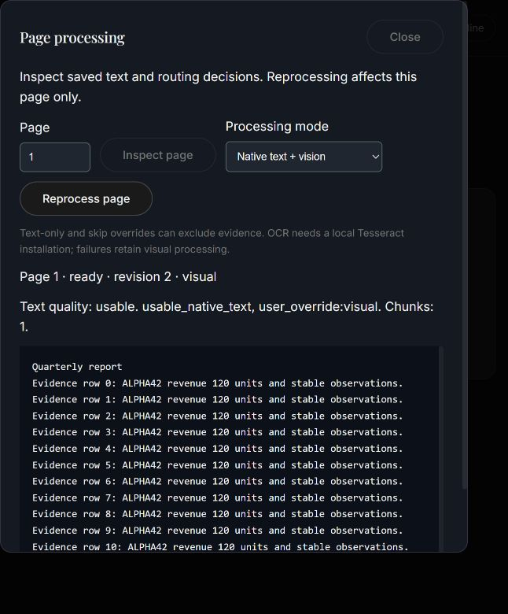

# Phase 3 — hybrid page ingestion

Implemented 2026-11-03. Stop before Phase 4. The original README is preserved.

## What changed

Every newly ingested page receives native Unicode text extraction and inexpensive
PDF object inspection before deciding whether to render or embed it. SQLite stores
the original extracted text, text quality, geometry, headings, routing reasons,
warnings, page processing revision, and bounded chunks. Text is retained on visual
pages. Originals remain immutable and available for previews and verification.

Ordinary usable prose takes the native text path. Substantial raster content,
vector graphics/table rules, uncertain text, columns, rotations, invisible text,
nested forms, and dense small text select additional visual processing. Empty pages
and small isolated decorations avoid model inference. These are conservative
heuristics, not learned classification or semantic correctness guarantees.

Missing or corrupted text selects local OCR when configured. Tesseract produces
line boxes and text with a deadline. An unavailable engine, timeout, malformed
output, or unusable OCR retains the visual path and a persisted warning. There is
no paid OCR service or automatic model download for routing. OCR does not replace
the saved native layer.

Chunks stay within one document version and page, prefer heading/line boundaries,
preserve heading and intersecting text-object boxes, and have configurable overlap.
The budget is **UTF-8 bytes**, a conservative ingestion token budget rather than
a particular encoder's tokenizer count. Phase 4 must validate its own tokenizer,
special tokens, and context limit. Boxes use PDF bottom-left point coordinates;
OCR boxes on rotated pages are explicitly marked as rendered-orientation boxes.
Complex reading order and exact table structure remain uncertain and route to
vision; cross-page table cells are not automatically merged.

Text-only pages remain discoverable through SQLite FTS5. A transitional lexical
and visual rank alternation deduplicates pages without comparing raw scores.
Lexical sources have `score: null` and `channel: lexical`. Visual sources retain
their existing pooled ColPali score. This bridge is not the evaluated dense text,
fusion, MaxSim, reranking, or learned routing work planned for Phase 4. Generation
still uses the selected original page images, including text-only search hits.
Text-only ingestion and queries do not load ColPali unnecessarily; evidence image
rendering happens when a text page is actually selected for an answer.

## Run

Stop the existing server with Ctrl+C, then run:

```powershell
.\.venv\Scripts\python.exe -m vision_rag.api.main
```

Defaults enable hybrid ingestion. No changes to the private `.env` were needed;
credentials, GPU settings, and user documents were preserved. The Phase 2 local
single-process ownership and persistent Qdrant rules still apply.

New optional settings are documented in `.env.example`:

```dotenv
HYBRID_INGESTION=true
TEXT_CHUNK_LIMIT=1200
TEXT_CHUNK_OVERLAP=120
OCR_ENABLED=true
TESSERACT_EXECUTABLE=tesseract
OCR_LANGUAGE=eng
OCR_TIMEOUT_SECONDS=60
```

Overlap must be smaller than the chunk limit. Tesseract can be an executable on
PATH or an absolute executable path; install the desired language data separately.
See the [official Tesseract installation guide](https://tesseract-ocr.github.io/tessdoc/Installation.html)
and [TSV command interface](https://tesseract-ocr.github.io/tessdoc/Command-Line-Usage.html).
`/api/v1/diagnostics` reports whether the executable is available. Availability is
not proof that language data or recognition quality is correct. Tesseract was not
installed during this phase; real OCR recognition remains unverified on this PC.

## Existing libraries and page overrides

Metadata schema 1 migrates transactionally to schema 2, preserving documents,
versions, jobs, and vectors. SQLite must include FTS5, as the tested Python build
does. Old code rejects schema 2; do not downgrade code against this library.
General index migration/rollback remains Phase 4.

Previously ready Phase 2 pages keep their visual vectors. There is no surprise
bulk reprocessing of the user's existing library. New uploads use hybrid ingestion;
deduplicated old uploads keep their existing job. Use **Document Library → Page
processing** to inspect or process an existing page. No user PDFs were migrated
or benchmarked during development.

Choose automatic, native text + vision, native text + OCR + vision, native text
only, or skip. Text-only and skip can deliberately exclude evidence. The task is
saved before HTTP 202 returns, and only the selected page is reprocessed. Other
pages retain their revisions and evidence. Pending/failed page evidence is hidden
from lexical and visual search; originals remain inspectable. A successful
revision publishes its chunks and page decision together under the query lock.
Restart requeues running page tasks. Reprocessing the same page again after a
failure creates a new durable task; duplicate simultaneous requests return 409.
Deletion immediately hides all evidence and cleanup removes chunks as well as
managed vectors/files. Page task execution enforces the original build profile.

The UI displays extraction, reasons, warnings, and revision; pending tasks refresh
and failed tasks expose a new reprocess action. OCR warnings can accompany a
successful visual fallback, so a ready page does not imply OCR succeeded.



## API

| Method | Route | Result |
| --- | --- | --- |
| GET | `/api/v1/versions/{version}/processing?limit=50&offset=0` | Paged decision summaries and recent tasks; maximum limit 100 |
| GET | `/api/v1/versions/{version}/pages/{page}/text` | Native extraction, warnings, chunks, current revision, latest task |
| POST | `/api/v1/versions/{version}/pages/{page}/processing` | Body `{"mode":"auto"}`; durable page task, HTTP 202 |
| GET | `/api/v1/page-tasks/{task}` | Typed saved state, attempts, error, page/version/build IDs |

Page numbers are one-based. Workspace and document tombstone checks apply to all
these routes. Unknown/deleted resources return 404; incompatible or unfinished
builds and duplicate queued page tasks return 409; invalid modes return 422.
Stats include `pending_page_tasks` and exclude hidden points from ready counts.
Authentication for shared deployment remains later-phase work.

## Measured comparison

Raw output: [phase3-benchmark.json](phase3-benchmark.json).

Windows 11, RTX 4050 Laptop GPU (6141 MiB), driver 617.14, Torch
2.13.0+cu130, ColPali v1.3, CUDA auto precision (float16), batch one, 150 DPI.
Six generated pages: prose, mixed prose/vector table, vector table, scan, blank,
and prose/logo. Each case used a fresh disk library and application artifact cache.
The encoder was loaded once; cases ran in the displayed order, so OS/model warmup
can favor later cases. This is a small repeatable diagnostic, not a universal
speedup or held-out quality evaluation. OCR was disabled in every benchmark case.

| Path | Ingestion seconds | Visual vectors | Chunks | Disk bytes | Median retrieval ms | Gold-page hit@3 |
| --- | ---: | ---: | ---: | ---: | ---: | ---: |
| All visual (Phase 2 path) | 34.39 | 6 | 0 | 1,498,176 | 60.2 | 3/3 |
| Selective | 15.74 | 3 | 4 | 1,108,639 | 52.2 | 3/3 |
| Native text only | 0.61 | 0 | 4 | 288,931 | 5.5 | 2/3 |

Model construction was 20.85 seconds, excluded from ingestion. Retrieval timings
exclude generation and evidence image preparation. Three synthetic questions
checked only presence of a gold page among three results; these tiny, permissive
checks do not establish ranking quality or answer correctness. Native-only missed
the scanned page; the other paths found it. No Gemini calls were made.

Peak CUDA allocation was about 8.11 GiB, exceeding physical 6 GiB VRAM under
Windows memory management. The run completed, but this does not establish that
the model fits physical VRAM or works equally on RTX 3050 hardware. Queue delay,
provider cost, answer latency, and other hardware were not measured.

Reproduce, allowing public processor metadata lookups:

```powershell
.\.venv\Scripts\python.exe scripts/benchmark_phase3.py --allow-downloads --output Docs/phase3-benchmark.json
```

Without `--allow-downloads`, the script forces offline operation. The offline
attempt failed on processor metadata despite cached weights; its report is kept
in [phase3-benchmark-offline.json](phase3-benchmark-offline.json). Online processor
resolution succeeded. No offline model readiness claim is made.

## Validation and remaining limits

Final verification: **79 tests passed**, with two upstream deprecation warnings.
Ruff, strict mypy (24 source files), Python compilation, JavaScript syntax, and
Git whitespace checks passed. The original README has no diff from Phase 2.

Automated regression coverage includes actual PDF extraction/rendering, vector
tables, small decorations, columns, rotation, dense footnotes, invisible/corrupted
layers, cross-page table identity, Unicode byte bounds/overlap, native text on
visual pages, OCR timeout/unavailability/TSV geometry, SQLite migration, scope,
partial page overrides on old indexes, failed/restarted tasks, persistent vector
counts, deletion, and text-only API answers without loading the visual model.
Routine inference/provider doubles are distinct from the real CUDA benchmark.

The browser check used the computer-use skill and an isolated synthetic library
with fake inference and real SQLite/Qdrant. A text page was inspected, overridden
to vision, and visibly reached revision 2 while preserving its text. The server
and temporary browser tab were closed after verification.

Layout detection can miss or overselect visuals; native text can be readable but
semantically wrong. Overrides are the recovery path. OCR recognition/language
quality, faithful table reconstruction, complex reading order, real-document
quality, and held-out answer quality remain unverified. There is no Docling model,
dense text encoder, trained query router, or MaxSim implementation in this phase.
These limits are not reported as passing checks.

Phase 4 has not started.
