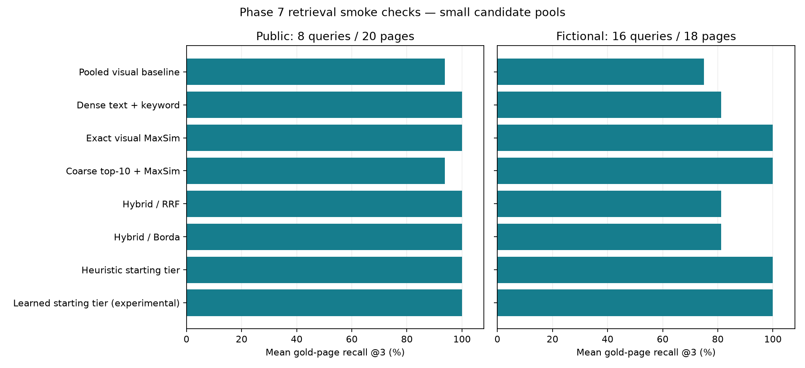

# Phase 7 benchmark

Recorded on the RTX 4050 Laptop; local smoke experiments, not an official benchmark or production approval.

## Retrieval relevance

| Policy | Public recall@3 | Public complete coverage@3 | Internal recall@3 |
| --- | ---: | ---: | ---: |
| Pooled visual baseline | 93.75% | 87.50% | 75.00% |
| Dense text + keyword | 100.00% | 100.00% | 81.25% |
| Exact visual MaxSim | 100.00% | 100.00% | 100.00% |
| Coarse top-10 + MaxSim | 93.75% | 87.50% | 100.00% |
| Hybrid / RRF | 100.00% | 100.00% | 81.25% |
| Hybrid / Borda | 100.00% | 100.00% | 81.25% |
| Heuristic starting tier | 100.00% | 100.00% | 100.00% |
| Learned starting tier (experimental) | 100.00% | 100.00% | 100.00% |

Public: eight English questions, 20 pages, two OpenStax books from [ViDoRe V3 computer science](https://huggingface.co/datasets/vidore/vidore_v3_computer_science), revision `d5cc75883d92e294f0c0fc2662551c9708a06ebc`. CC-BY-4.0; attribution: ViDoRe V3 contributors and OpenStax textbook authors. Selection is fixed before inference: first eight English queries with one to three positive pages, all gold pages plus eight fixed corpus-ID distractors. This gold-enriched pool is much easier than full-corpus retrieval. Scores are not official ViDoRe results.

Internal: 16 questions over 18 candidate pages from generated Juniper, Basalt and Granite reports. Includes numbers, identifiers, tables, charts, image-only scans and sampled pages from a 64-page PDF. All versions of these families are held out from Phase 4 router training. Related versions occur together only inside the held-out product split. The corpus is synthetic and template-based; its results do not establish generalization.

Both runs use identical candidate pages for all policies, 150 DPI, pinned BGE/ColPali revisions and original token matrices. Text uses native extraction without OCR in this experiment. Exact scoring runs locally in NumPy; coarse reranking is simulated from cached exact scores and is not a latency optimization measurement. Learned and heuristic rows choose starting tiers without generation/escalation; the unmodified synthetic router is evaluated out of domain and remains disabled in normal use.

Coarse candidate recall@10: public 93.75%; internal 100.00%. The public coarse stage drops relevant evidence. Hybrid improves over pooled retrieval here, but loses three internal scan queries that exact visual retrieval finds. No policy is declared best for general use, and no router cost win is claimed.

## Timing and memory

| Measurement | Public | Internal |
| --- | ---: | ---: |
| Warm dense encoding + scoring (mean, queries 2+) | 39.52 ms | 32.41 ms |
| Warm visual query encoding (mean, queries 2+) | 65.18 ms | 56.86 ms |
| Exact scoring over candidate tokens (mean) | 15.22 ms | 12.10 ms |

Timing excludes provider generation, database filtering and most application work; text timing also excludes keyword fusion. First query visual encoding can include lazy model loading; inspect raw samples. Cached subset preparation is not cold ingestion throughput. The separate [uncached internal run](phase7-internal-cold.json) prepared 18 pages in 117.78 seconds including model loading (0.153 pages/s), outside the durable application ingestion pipeline. It measured a peak CUDA allocator value of 8.71 GB and process RSS of 4.47 GB. CUDA allocator bytes are not a measurement of physically resident VRAM; the laptop has about 6 GiB of GPU memory and Windows may oversubscribe it. This does not prove the workload fits a 4 GiB card.

Original float32 tokens occupy about 1.06 MB/page before compression; compressed token files are about 0.305 MB/page. These are token-only storage figures, excluding PDFs, page caches, indexes and SQLite. Hardware, Torch/CUDA versions, exact profiles, source hashes and per-query results are in [public](phase7-retrieval.json) and [internal](phase7-internal.json) records. Only the RTX 4050 Laptop is measured; RTX 3050 and other systems are unmeasured.

## Answer quality and provider cost

The real streaming check passed: first provisional claim delta 5.53 s, completion 5.57 s. This is adapter latency, not browser TTFT. A supplied-gold version-comparison sample correctly reported 137 and 163 million EUR with valid references. Remaining product checks and the prompted router baseline stopped on HTTP 503; inspect the checkpointed [provider](phase7-provider.json) and [answers](phase7-answers.json) reports. Resume scripts skip completed requests and stop at the first new error.

Token usage is recorded where supplied by the provider. Dollar cost is unknown, not zero; no verified account billing rate is available. Phase 4's [cost/quality comparison](phase4-cost-quality.png) remains a synthetic cached-tier experiment. Partial prompted routes are not compared against full test-set means. Independent semantic support, representative answer correctness/abstention and human time-to-verify are unmeasured. Routine contract and browser tests do not fill those gaps.
