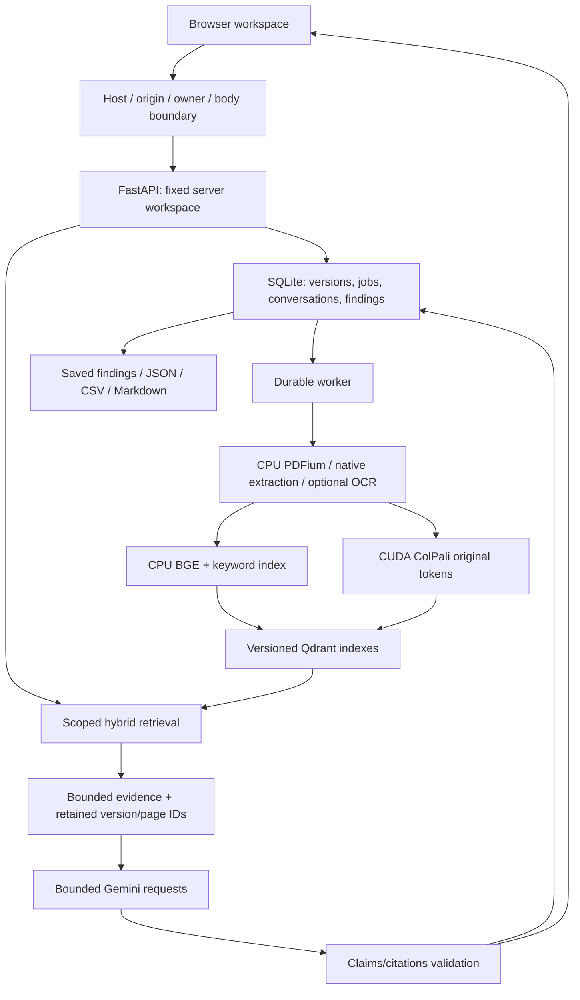

# Phase 7 — evaluation, hardening and release

Closeout: 6 November 2026. The supported validation target is one Windows
application process, one owner, SQLite and embedded persistent Qdrant. This is a
local release candidate; production/shared readiness is not established. This
guide records Phase 7 scope and validation. The [current README](../README.md)
also covers the later workspace redesign and current entry points.

## Run the application

Use the configured environment without syncing away its CUDA overlay:

```powershell
.\.venv\Scripts\python.exe -m vision_rag.api.main
```

Open http://127.0.0.1:8000. If that port is occupied, use the existing instance or
set `$env:BIND_PORT='8001'` before starting another process with a different
`DATA_DIR`. One process owns a library; two processes must not open the same data.

For a fresh Windows/Python 3.14 environment:

```powershell
uv sync --frozen --extra dev --extra evaluation
uv pip install --python .venv/Scripts/python.exe -r requirements/cuda-windows-py314.txt
.\.venv\Scripts\python.exe scripts/check_gpu.py
```

Copy `.env.example` to `.env` only when `.env` does not already exist. Set your own
Google key and an available generation model. Ingestion/retrieval models are
downloaded on first use; provider-free Find pages still requires local encoders.
Optional OCR setup is in [Phase 3 guide](Phase%203%20guide.md). PDFium renders pages
on the CPU; ColPali embeddings use CUDA. Normal `uv sync`/`uv run` can replace CUDA
Torch; use `.venv` Python or `uv run --no-sync` after applying the CUDA profile.

## Access and request boundaries

Local mode binds loopback and uses explicit allowed hosts. To enable owner
sign-in locally, set `ACCESS_TOKEN` to a private random value of at least 32
characters and restart. Leave it empty for anonymous loopback use. Never commit
the real token. Browser sign-in exchanges it for a random HttpOnly, SameSite
Strict session cookie; it is not persisted in local/session storage or URLs.
Logout revokes that session for subsequent requests. Restart revokes all browser
sessions; rotating the owner token requires updating configuration and restarting.

All API resources, source files, previews, events, conversations, findings,
exports and OpenAPI require the same owner authorization when enabled. `/health`,
the static shell and session-status/login endpoints are public. There are no
separate users, roles, tenant invitations or client-selected workspaces.

Host/origin checks, bounded login failures, content-length and streamed-body
limits run before multipart parsing and document work. Upload bodies default to
102 MiB (including multipart framing); other bodies are limited to 1 MiB and
login to 4 KiB. PDF upload/page/render limits still apply separately. CSP, no-store
API responses, secret-safe validation errors, masked configured credentials in
logs, bounded provider attempts and cancellation supplement existing controls.
Keep verbose third-party HTTP logging off. Interactive Swagger/ReDoc assets may
be blocked by the strict CSP; use authenticated OpenAPI JSON or the examples below.

Network configuration requires the authenticated profile, a token, secure
cookies, explicit hosts and an explicitly trusted TLS proxy. Only configured
proxy IPs may supply forwarded headers; plaintext network API requests are
rejected. This is a guardrail, not a verified shared deployment profile. CORS is
empty by default; explicit bearer-client origins do not receive cookie credentials.

## Architecture



Citation-reference validation does not establish semantic support. Document
instructions remain untrusted data; the model receives a containment instruction,
not permission to run tools or access the filesystem. Prompt injection cannot be
declared solved from contract tests alone.

## Offline backup and restore

Stop the application first. These commands target embedded persistent Qdrant:

```powershell
.\.venv\Scripts\python.exe -m vision_rag.backup keygen backups/library.key
.\.venv\Scripts\python.exe -m vision_rag.backup create data backups/library.zip --key-file backups/library.key
.\.venv\Scripts\python.exe -m vision_rag.backup restore backups/library.zip restored-data --key-file backups/library.key
```

Create refuses a running library or an existing archive. Restore refuses an
existing destination. It authenticates the manifest with HMAC before extraction
or Qdrant deserialization, checks file hashes, safe paths, extraction limits,
SQLite integrity, retained originals and vector collection counts, then publishes
the validated new directory. The default extraction cap is 8 GiB / 100,000 files.
Qdrant local storage uses pickle internally, so only authenticated archives from
your own trusted backup process should be opened.

Keep the key separate and restrict filesystem access. Authentication is not
encryption: archives contain document content and library history. Lost keys
cannot authenticate a restore. Configuration, API keys, model downloads and page
caches are excluded; PDFs, SQLite and Qdrant are retained. Page images regenerate
from retained originals. Test the restored library with `DATA_DIR=restored-data`
before replacing your working setup. Preserve the original until that check passes.

## Evaluation and release checks

See [Phase 7 benchmark](Phase%207%20benchmark.md) for hardware, comparisons,
timing/cache qualifications and the measured quality tradeoffs.

```powershell
.\.venv\Scripts\python.exe -m pytest -q
.\.venv\Scripts\python.exe -m ruff check src scripts tests
.\.venv\Scripts\python.exe -m mypy src
.\.venv\Scripts\python.exe -m scripts.evaluate_phase7
.\.venv\Scripts\python.exe -m scripts.evaluate_phase7 --internal --work-dir .tools/phase7-internal --output Docs/phase7-internal.json
# Optional live API calls; fictional data only, completed samples are checkpointed.
.\.venv\Scripts\python.exe scripts/check_phase7_provider.py --resume-router
.\.venv\Scripts\python.exe -m scripts.check_phase7_answers
uv build --wheel --out-dir .tools/release-dist
.\.venv\Scripts\python.exe scripts/check_wheel.py .tools/release-dist/vision_native_rag-0.1.0-py3-none-any.whl
.\.venv\Scripts\python.exe scripts/check_release.py --require-release
```

`--require-release` intentionally exits nonzero while any release gate remains
unverified. It checks source fingerprints against the verification record;
changing source/config invalidates prior verification. The JSON reports are
reviewable evidence records, not a substitute for rerunning checks or an automatic
production approval. Routine tests make no provider calls or model downloads.

The public dataset is a pinned CC-BY-4.0 ViDoRe V3 subset; downloads stay under
ignored `.tools`. Generated [demo PDFs](../examples/phase7-demo) and their gold task
manifest are CC0; no customer data is shipped. Internal families and all versions
stay outside the Phase 4 router's development families.

## Packaging and remaining release gates

The wheel smoke uses a fresh data directory and imports the packaged code outside
the checkout, with dependencies supplied by the current environment. It verifies
static assets, health, owner login/logout, protected APIs and OpenAPI. It does not
prove a fresh dependency installation on another machine.

The Dockerfile pins its Python base by digest and uses the frozen uv lock, a
non-root user and a separate library directory. Docker is unavailable here, so
container build/runtime, Linux GPU support and TLS/shared deployment are unverified.
The recipe is CPU-only and binds container loopback. On a Linux Docker host,
`--network host` can expose that loopback service to the local host; ordinary
`-p` forwarding does not reach container loopback. Do not widen the binding to
work around this without configuring and verifying the authenticated TLS profile.
The separate compose file is an optional legacy Qdrant server experiment, pinned
and restricted to localhost; it is unnecessary for embedded local mode.

The recorded dependency audit dropped from 62 advisories to one after available
fixes. Accelerate's checkpoint traversal advisory has no listed patched version;
load only trusted pinned checkpoints and do not accept model uploads. CUDA wheels
were skipped by the auditor. Older Python profiles may resolve older dependencies
and have not been audited. See [dependency record](phase7-dependencies.json) and
the [upstream advisory](https://github.com/advisories/GHSA-4j2p-28q2-5m79).

Incomplete provider comparisons, independent semantic support, representative
answer/abstention quality, human verification timing, RTX 3050 measurements,
container runtime and shared deployment remain explicit gates. Their absence is
not replaced by mock results or estimates. See the [feature matrix](Feature%20matrix.md).

## API examples

In PowerShell, use a private environment variable for the owner token:

```powershell
$headers = @{ Authorization = "Bearer $env:VISION_OWNER_TOKEN" }
Invoke-RestMethod http://127.0.0.1:8000/health
# { "status": "ok" } — liveness only, not model/provider readiness.
Invoke-RestMethod http://127.0.0.1:8000/api/v1/session
# With owner protection before login: { "required": true, "authenticated": false }
Invoke-RestMethod http://127.0.0.1:8000/openapi.json -Headers $headers
curl.exe -H "Authorization: Bearer $env:VISION_OWNER_TOKEN" -F "file=@examples/phase7-demo/Juniper-2025.pdf" http://127.0.0.1:8000/api/v1/ingest
```

Ingestion returns HTTP 202 with a durable job (`id`, `document_id`, `version_id`,
`state`, `pages_done`, `total_pages`, `error`, timestamps). Poll
`GET /api/v1/jobs/{id}` until ready/failed/cancelled. Build/activate a retrieval
index through the UI before querying a newly indexed library. All examples use
the same fixed owner workspace; credentials never belong in source/download URLs.
