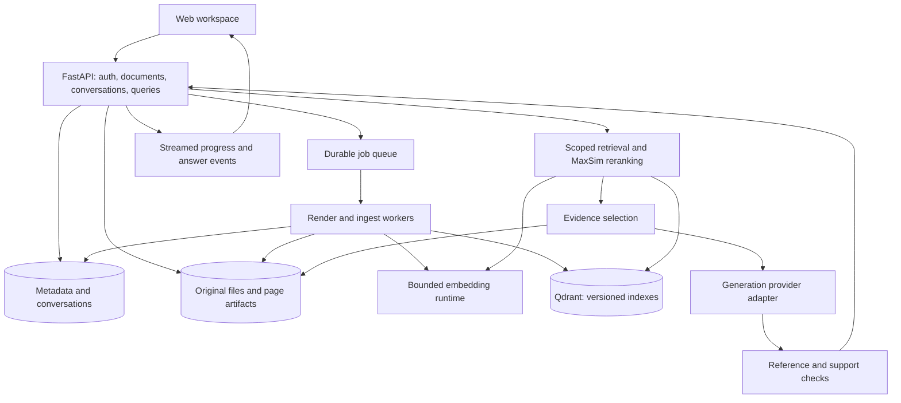

# Vision: research and product upgrade strategy

Research date: 2 November 2026. Scope: product positioning, retrieval, evidence, user experience, backend, operations, evaluation, and delivery. This is a recommendation document; it does not describe implemented upgrades.

## 1. Recommended direction

Build **a visual evidence workspace for comparing complex documents**. The central promise should be: ask a question, inspect the evidence, compare sources, and export a result whose claims can be traced back to a specific document version and page.

Start with financial and technical reports containing dense tables, charts, footnotes, and revisions. This is a proposed initial market, based on the project's page-image pipeline, rather than validated customer demand. Interview five to ten intended users and observe actual comparison tasks before committing to a broad commercial positioning.

The differentiating workflow is: select reports → ask a comparison question → see a source-linked comparison table → open the relevant page or crop → inspect units, dates, and disagreements → export the result with provenance. Broad format support and attractive chat are useful, but insufficient differentiation on their own.

The recommended first release combines:

1. Reliable document ingestion and persistence.
2. Correct, evaluated visual late-interaction retrieval.
3. An evidence viewer with claim-to-page citations.
4. Document-scoped conversations and comparison tables.
5. A reproducible benchmark and honest performance report.

## 2. What the research changes

**Visual document retrieval is established, but fine-grained grounding remains difficult.** ViDoRe V3 includes approximately 26,000 pages and 3,099 human-verified queries in six languages, with retrieval relevance, bounding-box, and answer annotations. Its authors report remaining difficulties with non-textual evidence and detailed grounding. Evaluate retrieval and answer correctness separately. [ViDoRe V3 paper](https://arxiv.org/abs/2601.08620)

**True MaxSim requires a scaling design.** Qdrant's tutorial recommends compressed multivector candidate retrieval followed by original-multivector reranking, disabling HNSW for the original representation in that design. This provides a relevant implementation starting point; its performance claims are not measurements of Vision. [Qdrant tutorial](https://qdrant.tech/documentation/advanced-tutorials/pdf-retrieval-at-scale/)

**Citations, collection management, and hybrid retrieval are existing expectations.** Kotaemon already documents these capabilities, including highlighted PDF previews. Onyx emphasizes permission-aware connectors. NotebookLM offers source-to-table workflows. Vision should compete on the quality of evidence inspection and comparison rather than on a generic feature checklist. These vendor/project descriptions establish available features, not independent quality rankings. [Kotaemon](https://github.com/Cinnamon/kotaemon), [Onyx connectors](https://onyx.app/connectors), [NotebookLM data tables](https://blog.google/innovation-and-ai/models-and-research/google-labs/notebooklm-data-tables/)

**A patch map explains retrieval similarity.** ColPali's implementation computes query-token-to-image-patch similarity overlays. These are not validated bounding boxes and do not establish that a generated statement follows from the page. Label the feature “retrieval similarity”; keep it separate from verified evidence regions. [ColPali implementation](https://github.com/illuin-tech/colpali/blob/main/colpali_engine/interpretability/similarity_maps.py)

**Vision-native need not forbid text.** Preserve page images as primary evidence. Add native PDF text and optional structured extraction when useful for exact identifiers, table exports, accessibility, and lexical retrieval. Docling provides a document representation with tables, pictures, and provenance that merits a bounded trial. [Docling document model](https://github.com/docling-project/docling/blob/main/docs/concepts/docling_document.md)

## 3. Current implementation: constraints that matter

The baseline is documented in `Docs/Project understanding.md`; key code paths were re-read for this research. Findings below come from the repository, rather than internet sources.

| Current behavior | Product consequence | Required change |
|---|---|---|
| Image patches and query tokens are averaged into one vector | ColPali's intended late interaction is lost | Preserve multivectors; compare against current baseline |
| Default Qdrant store is in memory | Uploaded files survive while search disappears on restart | Durable index and an authoritative metadata store |
| Random vector IDs on repeated upload | Duplicates and stale page references | Content hashes, document versions, deterministic page IDs |
| Full PDF rendering during queries and previews | Avoidable delay and memory pressure | Cached renditions and single-page rendering |
| Synchronous inference inside async endpoints | Unrelated requests can stall | Explicit inference concurrency and durable ingest jobs |
| Generator receives unlabeled images | Source list cannot establish claim support | Stable evidence IDs and structured claim references |
| Chat exists in browser session storage | Follow-ups have no backend context | Stored conversations with scoped retrieval |
| Broadly unvalidated filenames and request sizes | Unsafe storage and resource exhaustion risks | Server-generated storage keys, containment and bounded work |
| Statistics wrapper reads an absent Qdrant attribute | Misleading dashboard | Adapter fix and an explicit unavailable state |
| Illustrative dashboard analytics | Users cannot trust displayed activity | Real events or clearly labeled sample data |

Earlier lint/type/test counts are historical inspection results, not new validation. No inference, benchmark, deployment, or provider call was performed for this research.

## 4. Feature priorities

Priority expresses dependencies and expected value, not experimentally measured ROI. Effort is relative: S = a focused change, M = several components, L = a substantial workflow, XL = a separate product capability. These are not delivery promises.

| Capability | Priority | Effort | Reason / acceptance evidence |
|---|---|---|---|
| Safe, durable, idempotent ingest | P0 | L | Restart/retry/re-upload do not corrupt document state |
| Retrieval benchmark and traces | P0 | M | Baseline and upgrade results reproducible on held-out questions |
| True multivectors with versioned reindex | P0 | L | Retrieval quality measured against pooled baseline |
| Split-pane evidence viewer | P1 | L | Each citation opens the correct document version and page |
| Collection/document filters | P1 | M | Scope and permissions enforced before candidate selection |
| Persistent conversational context | P1 | M | Follow-ups resolve selected evidence without inventing facts |
| Real ingest progress, cancellation, retry | P1 | M | UI distinguishes uploading, rendering, embedding, indexing |
| Source-linked comparison tables | P1 | L | Every factual cell has evidence; missing values are explicit |
| Streaming with cancellation | P1 | M | Ordered events, clean disconnect handling, final citations |
| Numeric extraction plus deterministic calculations | P2 | L | Units/periods retained and calculations reproducible |
| Version comparison and conflict review | P2 | L | Changes point to old and new source versions |
| Retrieval similarity overlays | P2 | M | Overlays align with page geometry and are correctly labeled |
| Select a region and ask | P2 | L | Crop maps back to source page and original coordinates |
| PNG/JPEG ingestion | P2 | S–M | Same artifact/evidence contract as PDF pages |
| DOCX/PPTX ingestion | P2 | L | Conversion fidelity checked; original preserved |
| Local generation profile | P2 | L | Verified hardware requirements and no hidden cloud requests |
| Connector sync with ACL propagation | P3 | XL | Deletions, revocations, freshness and failures are handled |
| Cross-language retrieval | P3 | L | Per-language evaluation supports explicit claims |
| Knowledge graph or autonomous research agents | Conditional | XL | Add only for a measured task that simpler retrieval fails |

P0 is needed before a dependable release; it does not imply that every P0 task must finish before evidence-viewer design starts.

## 5. The standout workflows

### A. Evidence inspection

Use three resizable areas: collections/documents; conversation or findings; document evidence. Clicking a citation selects a stable page, preserves zoom and scroll, and optionally shows an extracted evidence region. Keep filenames, version, page number, and evidence status visible.

Return structured claims with evidence IDs. Validate that IDs belong to the evidence actually supplied to the generator. A valid reference only proves referential integrity; semantic support still requires checking the page against the claim. Mark unresolved claims as unverified, and allow corrections. Page-level citations are a useful first release; region-level precision is a later acceptance milestone.

Use normalized coordinates with a documented origin, rotation, and render transform. Preserve original dimensions, crop coordinates, and processor padding information. Avoid inferring precise boxes merely by thresholding an attractive heatmap.

### B. Comparisons with evidence in every cell

Example: “Compare operating margin in the 2024 and 2025 reports, and explain the difference.” Retrieve independently within each requested source/version, extract the relevant figures and period labels, then build the table. Show missing evidence, incompatible accounting periods, and differences between reported and calculated values.

For a numerical field store: raw source text, parsed decimal value, unit, currency, reporting period, document version, evidence reference, and review status. Calculate deltas using Decimal or another controlled numeric library. An LLM can propose extraction and explanation; arithmetic should run through validated functions. If data cannot be reconciled, show the conflict rather than choosing silently.

### C. Revision review

Compare version A with B using page alignment first, then selected text/table/image comparisons. Distinguish formatting changes from candidate semantic changes. A missing sentence alone does not prove a contractual or policy change. Show both sources and let the user confirm material findings.

This capability depends on versioned documents and stable artifacts. It should follow the comparison workflow rather than being implemented as a superficial whole-page pixel diff.

### D. Region questions and chart inspection

Let users draw a rectangle over a table, diagram, or chart and ask about it. Send the crop alongside full-page context when necessary; preserve axis labels, legends and footnotes. Provide a clearly labeled approximate value when a chart only permits visual estimation. A crop or generated table must remain connected to the exact source version.

### E. Shareable evidence reports

Save findings, comparison tables and selected crops into a report with page citations, generation timestamp, source hashes, model/configuration versions and a verification status. Begin with Markdown/HTML plus CSV/JSON. Add polished PDF or DOCX exports only when evidence links and layout are reliable. Exports can disclose source content; enforce workspace permissions when creating and downloading them.

## 6. Retrieval and model strategy

### Correctness before model replacement

Keep ColPali v1.3 as the controlled baseline. Update the embedding contract from unstructured lists to a typed representation containing vectors, model revision, dimension, mask/length, and image-grid information. Handle image/query padding and special tokens according to each model's scoring implementation. Do not assume every model uses a 32×32 grid or 128 dimensions.

Create a new schema-versioned collection. Preserve original multivectors for reranking and, where supported, compressed representations for candidate search. Start with exact MaxSim on a small labeled corpus to obtain a reference result, then introduce an approximate candidate stage and measure its recall loss.

Proposed query flow:

1. Authorize workspace, collection and document scope.
2. Resolve a follow-up into an explicit search question while retaining the original question.
3. Generate visual candidates and, optionally, native-text/lexical candidates.
4. Fuse candidate ranks; deduplicate pages and apply source diversity rules.
5. Rerank candidates using original multivectors.
6. Add neighboring pages only when needed, with a bounded evidence budget.
7. Select evidence, label images, synthesize, validate references, and assess support.

Start by testing candidate sets of 50/100/200 and final contexts of 3/5/8 pages. These are experimental sweep values, not tuned defaults. Larger contexts and additional rerankers can worsen cost, latency or distractibility.

Qdrant supports rank fusion and multistage queries; RRF is a practical experiment when score ranges differ. Document metadata filtering is not itself hybrid search. A hybrid system needs distinct retrieval signals, such as lexical and visual rankings. [Qdrant hybrid queries](https://qdrant.tech/documentation/hybrid-queries/)

### Candidate models

| Candidate | Proposed role | Selection criterion |
|---|---|---|
| Existing ColPali v1.3 | Baseline, first correct MaxSim implementation | Establish the value of scoring correction |
| `vidore/colqwen2.5-v0.2` | Alternative visual multivector encoder | Quality/latency/storage on Vision's corpus |
| `athrael-soju/colqwen3.5-4.5B-v3` | Newer multivector challenger | Compatibility, license, memory and local evaluation |
| `Qwen/Qwen3-VL-Embedding-2B` | Alternative candidate encoder experiment | Recall per byte and end-to-end answer quality |
| `Qwen/Qwen3-VL-Reranker-2B` | Optional expensive reranking stage | Incremental benefit over MaxSim at acceptable latency |

These are research candidates, not equivalent drop-in replacements. Model families differ in loading code, dimensionality and preprocessing; benchmark and pin revisions separately. Model-card scores are author-reported and cannot be directly compared when benchmarks or metrics differ. [ColQwen2.5 card](https://huggingface.co/vidore/colqwen2.5-v0.2), [ColQwen3.5 card](https://huggingface.co/athrael-soju/colqwen3.5-4.5B-v3), [Qwen embedding card](https://huggingface.co/Qwen/Qwen3-VL-Embedding-2B), [Qwen reranker card](https://huggingface.co/Qwen/Qwen3-VL-Reranker-2B)

For generation, retain the provider interface and benchmark the configured model against a currently available quality candidate and a local option if privacy matters. Google's model catalog currently lists the configured Gemini 3.6 Flash; availability in this user's account remains untested. Select based on evidence accuracy, structured output validity, latency and actual billed usage. [Gemini model catalog](https://ai.google.dev/gemini-api/docs/models)

Structured outputs can enforce response shape; they cannot guarantee factual correctness. Use them for claims, citations, missing evidence and extracted values. [Gemini structured outputs](https://ai.google.dev/gemini-api/docs/structured-output)

### Storage economics

Illustration: 1,024 patches × 128 dimensions × 4 bytes = 524,288 bytes per page, or 0.5 MiB of raw float32 vectors. At 100,000 pages this is about 48.8 GiB before payloads, indexes, images, replicas or database overhead. Actual token counts and storage formats differ. Float16, compression or quantization can reduce storage, but compatibility and retrieval loss must be measured. Page images may be another substantial storage component.

Do not build a full patch HNSW index by default, or enable binary quantization purely because it is available. Measure candidate recall, storage and reranking latency first.

## 7. Backend architecture

Prefer a modular Python application with a separate worker process. Keep FastAPI and Qdrant. Add a relational metadata store and artifact storage; introduce independent services only where workload or deployment requires them.



This diagram is a target architecture, not a description of the current deployment.

**Local profile:** SQLite metadata, local immutable artifact directory, persistent local/server Qdrant and a worker with persisted jobs. Support one known-good configuration first. **Team profile:** PostgreSQL, S3-compatible artifact storage, Qdrant server and a durable queue. A Linux/container worker is a practical choice for a Celery-based deployment from this Windows development environment; validate GPU/container support before promising one-command GPU setup.

Use a job abstraction so the implementation can evolve. FastAPI itself points to larger queue tools for heavy background computation. In-process background tasks alone do not provide restart-safe ingestion. [FastAPI background tasks](https://fastapi.tiangolo.com/tutorial/background-tasks/)

### Domain records

- Workspace and collection: membership, settings and scope.
- Document: stable identity, display name, ownership and lifecycle state.
- DocumentVersion: immutable content hash, original artifact, source metadata and timestamps.
- PageArtifact: page index, dimensions, rotation, thumbnail and reading-resolution asset.
- IndexBuild: model revision, schema, preprocessing revision and readiness status.
- IngestJob: stage, completed units, retry/cancellation state and error category.
- Conversation/Message: selected scope, original query, rewritten query and final answer.
- Evidence/Claim: source version, page/crop, statement, support status and provenance.
- QueryRun/Feedback: trace ID, config, retrieved IDs, stage latency and user correction.

### Ingestion consistency

Write the original under a generated key, calculate a content hash, and create a version record. Detect duplicates within the permitted scope; do not expose another workspace's file existence through global deduplication responses. Process bounded page batches. Save artifacts and vectors using stable page/version/index IDs, then mark the index build ready only when verified complete.

Use explicit states: uploaded → validating → rendering → embedding → indexing → ready, with failed/cancelled branches. Retry jobs idempotently and track partial work. Publish only ready versions to retrieval. Relational storage, object storage and Qdrant do not share one atomic transaction; use a durable outbox/reconciliation process and compensating cleanup.

Deletion immediately removes query visibility, then performs retryable artifact/vector cleanup. Reindex into a new collection, validate counts/schema/quality, switch an application index pointer or supported alias, and retain the old index for a bounded rollback period. Never silently mix incompatible embedding versions.

### Suggested code organization

```text
src/vision_rag/
  api/                  # HTTP models, routes, streaming
  application/          # ingest, query, compare, export use cases
  domain/               # document, version, evidence, job contracts
  retrieval/            # candidates, fusion, reranking, selection
  generation/           # prompts, structured responses, validation
  infrastructure/
    db/                 # metadata repositories and migrations
    artifacts/          # filesystem / object-store adapters
    embeddings/         # model-specific implementations
    vector_stores/      # Qdrant schema and queries
    providers/          # generation adapters
    jobs/               # queue and worker implementation
  evaluation/           # datasets, scoring, experiment manifests
  observability/        # logs, metrics, tracing
```

Move modules incrementally around working use cases. Keep interfaces only where there is a meaningful boundary; avoid creating an abstraction per function.

## 8. API and evidence contracts

Introduce versioned endpoints without abruptly breaking existing clients:

- Upload creates a document/version and returns HTTP 202 plus job ID.
- Job status exposes real processing stages; cancellation and retry are explicit operations.
- Queries accept collection/document version IDs, conversation ID and optional selected region.
- Page endpoints address stable IDs, authorize access and serve cached artifacts.
- Comparison creates a stored run whose output includes table-cell evidence.
- Exports refer to a saved result snapshot, with authorization checks on download.

An illustrative evidence reference:

```json
{
  "evidence_id": "ev_123",
  "document_version_id": "dv_456",
  "page_number": 12,
  "region": {"x": 0.12, "y": 0.31, "width": 0.62, "height": 0.20},
  "coordinate_system": "normalized_top_left_unrotated",
  "origin": "model_proposed",
  "support_status": "unverified"
}
```

Regions can be null for page-level citations. Keep extraction origin separate from validation status. Do not label a model-proposed box as verified by default.

For SSE use named, ordered events such as `retrieval_started`, `evidence_selected`, `answer_delta`, `answer_final`, and `error`. Final events contain authoritative structured citations. Partial streamed text can be provisional until support validation completes. Disconnect/cancel behavior needs explicit handling; stopping display does not necessarily stop provider billing. Configure request deadlines and clean resource release.

## 9. Visual design and product representation

Recommended information architecture: Workspace, Library, Compare, Saved Findings, and Settings. Make conversation an activity inside the workspace. Put service health and pipeline diagnostics in an administrative view.

The visual identity should emphasize readable documents and clear evidence: a neutral canvas, restrained emerald accent from the current design, strong typography, and enough contrast for dense tables. Offer light and dark themes, with document pages rendered faithfully in either. Avoid decorative charts and unexplained similarity percentages.

Key interactions:

- Select documents before asking; keep the current scope visible during follow-ups.
- Show stage-based ingestion progress and recoverable errors per file.
- Provide citation hover previews, keyboard navigation, resizable panes and persistent viewer position.
- Render readable comparison tables with units and period labels in headers.
- Distinguish evidence unavailable, extraction uncertain, sources disagree and provider unavailable.
- Support narrow-screen navigation rather than hiding it.
- Treat loading, empty, error, offline and cancellation states as first-class screens.
- Give useful sample documents and guided questions for an immediate demonstration.

Aim for WCAG 2.2 AA, with manual keyboard and screen-reader checks in addition to automation. Image-only document evidence needs accessible text or descriptions where feasible; a vision-only backend does not by itself solve accessibility. [W3C WCAG 2.2](https://www.w3.org/TR/wcag/)

A TypeScript frontend with a component system, typed API client and established viewer is reasonable as interaction complexity grows. React/Vite is an implementation option, not an essential product upgrade. Verify viewer licensing, document rendering fidelity, page-coordinate mapping and maintenance before selecting a library. First stabilize backend contracts and the viewer workflow; avoid coupling a cosmetic rewrite to a retrieval migration.

## 10. Security, reliability and observability

Before shared hosting, add authentication, per-workspace authorization and document ownership. Propagate scope to retrieval, artifacts, conversations, exports and caches. A hidden UI element is not access control.

Bound upload bytes, page counts, render resolution, batch size, queue length and per-user consumption. Validate actual file content; isolate risky conversion workloads; disable unneeded converter network access. Keep filenames as display metadata, use generated storage keys, and verify resolved paths remain contained. Sanitize rendered Markdown/HTML and remove filename interpolation into inline JavaScript.

Treat content inside document images as untrusted data. OWASP explicitly documents indirect and multimodal prompt injection. Prompt wording is one defense, not a security boundary. Keep generation read-only initially, with no arbitrary file/network tools, and enforce permissions outside the model. [OWASP prompt injection](https://github.com/OWASP/www-project-top-10-for-large-language-model-applications/blob/main/2_0_vulns/LLM01_PromptInjection.md)

Record separate liveness and readiness checks. Readiness should represent required dependencies for the advertised operation; document browsing should not require Gemini availability. Track ingestion pages/minute, queue age, GPU/host memory, query-stage p50/p95, cancellation, provider failures, token usage where available and artifact-cache hit rate. Use OpenTelemetry-compatible traces with trace IDs in recoverable error responses. GenAI conventions evolve, so pin the instrumentation version. [OpenTelemetry conventions](https://opentelemetry.io/docs/specs/semconv/)

Avoid logging full documents or prompts by default. Make cloud transmission explicit in settings: local embeddings plus cloud generation is not a fully local product. A local profile must verify outbound behavior. Define retention, backups and a restore drill covering metadata, originals and indexes together.

Deploy reproducibly: pinned dependencies and container versions, migrations, health checks, documented hardware, secret handling, smoke checks and a demo dataset. Begin with Compose; Kubernetes and multiple microservices are unnecessary until demonstrated load or operating constraints justify them.

## 11. Evaluation: what would prove improvement

Create a curated internal set of roughly 150–300 questions across 30–50 documents as an initial working target. Include simple text, dense tables, charts, diagrams, exact identifiers, multi-page reasoning, comparisons, revisions and deliberately unanswerable questions. Include real user tasks with consent. Keep development and held-out test sets separate at the document family/version level to limit leakage.

Use ViDoRe V3 subsets for external comparison and internal questions for product acceptance. Preserve exact dataset versions and check redistribution terms for any demo corpus. Automated judges assist review; a text-only judge cannot reliably verify visual evidence that it never receives.

| Layer | Measure | What it diagnoses |
|---|---|---|
| Candidate retrieval | Recall@50/100/200 | Whether reranking can possibly recover the right page |
| Final retrieval | nDCG@5, relevant-page recall@5 | Ordering and evidence coverage |
| Comparison | Coverage for each requested source | Whether one report crowds out another |
| Answer | Human rubric, numeric accuracy, unsupported-claim rate | Whether the result is usable and supported |
| Citations | Valid-reference rate, claim support, citation coverage | References versus actual evidence |
| Regions | IoU plus human evidence sufficiency | Coordinate precision and semantic usefulness |
| Abstention | Correct refusal and unnecessary refusal rates | Handling absent evidence without becoming unusable |
| System | p50/p95 stage latency, storage/page, cost/query | Quality under resource constraints |
| UX | Time to verify, task completion, corrections | Whether the workspace saves actual effort |

Run controlled experiments: pooled baseline → exact MaxSim → candidate/rerank approximation → alternative encoder → optional text branch → optional extra reranker. Keep generator and dataset fixed when comparing retrieval. Then compare generators using fixed evidence. Include confidence intervals or paired per-query results rather than a single flattering average.

Proposed initial release gates, to calibrate after baseline measurement:

- No observed cross-workspace exposure in the defined permission test matrix.
- Idempotent ingest and successful restart/retry/delete/reindex/restore scenarios.
- 100% syntactically valid evidence references in the release evaluation set.
- At least 95% supported cited claims on the curated human-reviewed set, reported with sample size and uncertainty.
- Measurable improvement in held-out retrieval without unacceptable latency/storage regression.
- A specified latency target on a named machine, corpus and concurrency level; no universal “instant” claim.

These are proposed engineering targets, not existing results or guarantees. A “95% supported claims” score must not be presented as 95% overall factual accuracy.

## 12. Delivery sequence

Use milestone exits rather than the old roadmap's optimistic day counts. A single developer should expect several substantive iterations; hardware, deployment target and user workflow remain unknown.

**Milestone 0 — trustworthy baseline.** Fix statistics and path handling, document runtime, make lightweight integration tests deterministic, create benchmark fixtures and collect stage timings. Exit: the current system can be measured and failures are visible.

**Milestone 1 — durable library.** Introduce metadata/version records, safe artifacts, deterministic ingest, persisted jobs, bounded batches and durable Qdrant. Add real document/job states. Exit: restart, repeated upload, partial failure and deletion preserve consistency.

**Milestone 2 — correct visual search.** Add exact multivector scoring, a versioned reindex, quality reports and candidate-stage experiments. Exit: quality gains and resource tradeoffs are demonstrated on held-out questions.

**Milestone 3 — evidence workspace.** Add source labels, structured citations, split-pane viewer, scope controls, persistent conversations and streaming. Exit: users can ask and verify an answer end to end without guessing which page supports it.

**Milestone 4 — distinctive analysis.** Add source-linked comparison tables, unit-aware calculations, saved findings and export. Then trial version comparison and region questions. Exit: a representative user completes a realistic multi-report task faster with fewer unsupported conclusions.

**Milestone 5 — shared operation.** Complete access controls, quotas, audit events, retention, backups, deployment documentation and optional connectors. Security boundaries must move earlier if any previous milestone is exposed to multiple users. Exit: a repeatable deployment/restore and a permission test report.

## 13. What to defer

- General autonomous agents before reliable retrieval and evidence contracts.
- Knowledge graphs without an entity/relationship task and an evaluation proving benefit.
- Simultaneous support for many model providers and file formats.
- Voice, video summaries and decorative dashboards before evidence verification works.
- Fine-tuning before scoring, preprocessing and corpus issues are ruled out.
- Claims of perfect visual understanding, verified heatmaps or universal retrieval superiority.

## 14. Demonstration and repository quality

Build a five-minute example around two reports with a dense table, one chart and a revised figure. Demonstrate source selection, a cited answer, cell-level comparison evidence, a disagreement, an unanswered question and an export. Show measured latency and source provenance rather than only a screenshot of generated prose.

Publish an honest README with a screenshot of the evidence workflow, an accurate architecture diagram, a setup path verified from a clean environment, API examples matching actual responses, evaluation methodology/results, model and dataset attribution, deployment profiles and known limitations. Add focused CI around domain logic, API contracts, storage/job consistency, deterministic Qdrant behavior and key browser flows. Model-dependent benchmarks can be separate scheduled/manual checks with pinned assets.

Track a small number of architectural decisions: multivector design, metadata ownership, document/version identity, job durability and evidence contract. Keep a feature matrix distinguishing shipped, experimental and planned behavior. This representation will strengthen the project more than an inflated list of unsupported capabilities.

## 15. Immediate implementation recommendation

Begin with a bounded vertical slice: one persistent document version → cached page artifacts → correct multivector retrieval → one labeled evidence page → one structured cited answer → one viewer action. Add deterministic tests and a small quality dataset around that slice. Once it works, extend to comparison tables.

The product hypothesis to test is concrete: **Vision helps a user verify and compare information in visually complex reports faster, with fewer unsupported claims.** Treat adoption and measured task performance as the decision criteria for subsequent features.
