# Vision upgrade history — from PDF chat prototype to document workspace

Written 9 November 2026. This document explains what changed, why it changed,
how it was implemented, and what has actually been verified.

**Before** means the original prototype inspected on 2 November 2026, with the
October UI screenshots below. **After** means the implemented Phases 1–7,
follow-up fixes, and the workspace redesign verified on 8 November. These are
implementation milestones, not invented release numbers: the package metadata
still identifies the project as `0.1.0`.

The baseline is taken from the [original code review](Research.md#original-code-baseline),
not from treating the old README's intended features as shipped behavior. The
[current README](../README.md) is the entry point for setup; the
[implementation plan](README.md#current-status) tracks phase completion and limits.

Navigate: [Pictures](#2-old-and-new-pictures) ·
[Before/after table](#3-before-and-after-at-a-glance) ·
[Architecture](#4-architecture-what-stayed-and-what-changed) ·
[Phases](#5-phase-by-phase-implementation) ·
[Measurements](#6-what-the-measurements-actually-show) ·
[Migration](#7-changes-developers-and-existing-users-need-to-know) ·
[Remaining work](#8-what-is-deliberately-not-claimed-complete).

## 1. What changed for the user

The original application let you upload a PDF, ask a question and view source
page cards. It demonstrated visual retrieval and generation, but library state,
processing recovery, source scope and conversation persistence were limited.

The upgraded application supports a complete local workflow:

1. Save a PDF in a durable library, with real processing and search-readiness state.
2. Select explicit documents for a persistent chat; keep each turn's source scope.
3. Ask a question or find pages locally without a generation-provider request.
4. Inspect the exact cited document version and original page.
5. Compare selected reports or retained versions, with cited factual cells and
   explicit missing evidence.
6. Save a finding, review its evidence, reopen it and export it.
7. Recover from failed work, clear selected kinds of data, or restore a backup.

It remains a **single-owner local application**. Adding these workflows does not
establish multi-user authorization, production readiness or general answer accuracy.

## 2. Old and new pictures

### Entry point: dashboard to working conversation

| Original interface — October 2026 | Current workspace — November 2026 |
| --- | --- |
|  | 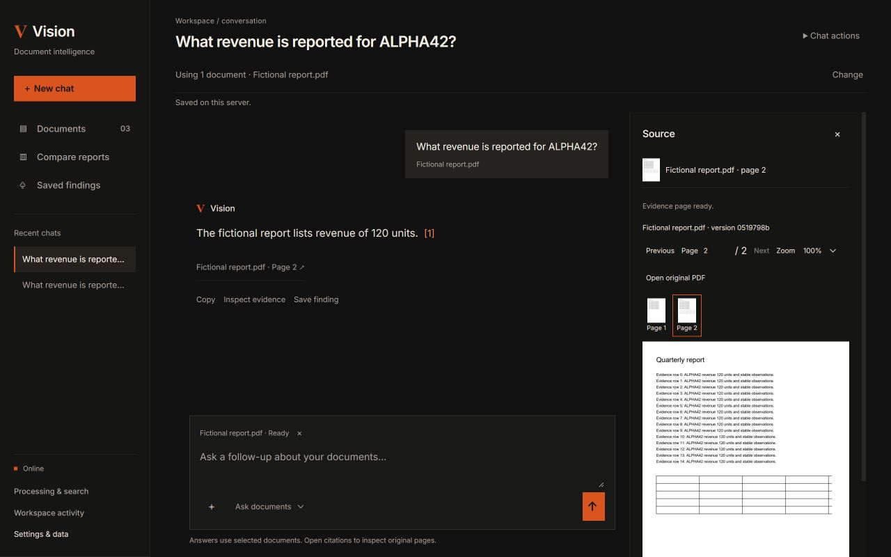 |

The old dashboard led with a promotional hero and illustrative activity bars.
The new entry point is chat, with recent conversations, document selection,
processing/readiness feedback, citations and access to saved findings. Workspace
activity now describes persisted library activity rather than invented analytics.

### Original chat and source cards

The original chat showed answers and page cards. Its history lived in browser
session storage, and questions were not sent with the durable conversation and
explicit selected-document scope used now. A raw retrieval score was shown beside
the source; it was not a calibrated confidence probability.

### Current evidence workflow

The current desktop view connects a submitted question, selected document,
inline citation, original page and retained version. A source drawer supports
page navigation, thumbnails, zoom and original PDF access without discarding the chat.

### Current mobile views

| Chat and composer | Original source page |
| --- | --- |
| 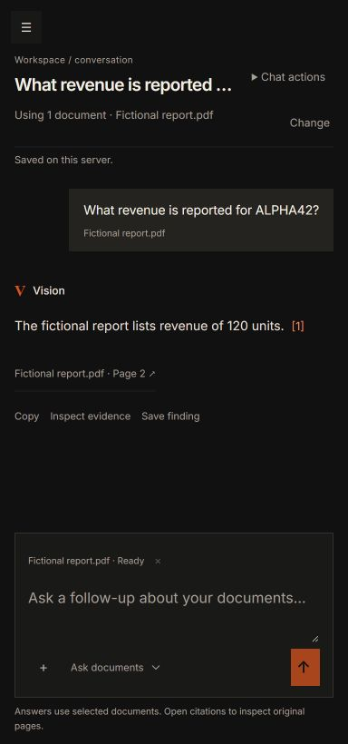 | 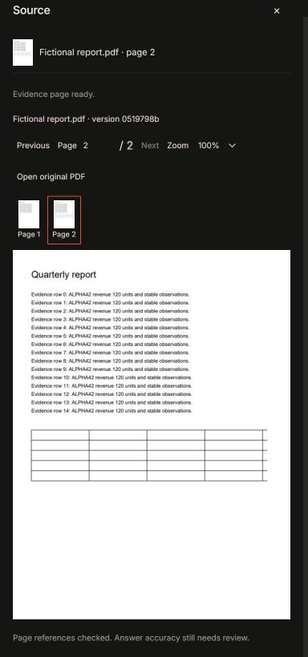 |

Mobile navigation replaces the old hidden navigation pill. Source inspection uses
a separate sheet with focus isolation and a return to the citation when closed.

**Image provenance:** the old pictures are existing repository screenshots from
20 October. The new pictures come from the 8 November isolated browser checks,
using generated fictional PDFs and simulated inference. They demonstrate the
interface and workflow, not real-provider answer accuracy. No images were generated
to imply capabilities that do not exist. See [UX verification](evidence/history.json).

## 3. Before and after at a glance

| Area | Original inspected implementation | Upgraded implementation |
| --- | --- | --- |
| Product entry | Dashboard, upload and basic PDF chat | Chat-first workspace, library, comparisons and findings |
| Ingestion | Work performed synchronously during upload | HTTP 202 job, durable background queue, progress, retry/cancel |
| Document identity | Display filename used as storage identity | Generated storage keys, document IDs, immutable version IDs |
| Duplicate/replacement behavior | No durable content deduplication or version transaction | Content hashes, scoped deduplication and explicit replacement |
| Metadata | Files and vector payloads | SQLite documents, versions, pages, builds, jobs and review records |
| Default vector storage | In-memory Qdrant | Disk-backed embedded Qdrant, isolated retrieval profiles |
| Page counting | Render PDF pages to count them | Read metadata without rasterization |
| Preview/query rendering | Re-render an entire PDF to use selected pages | Render requested pages, cache pages/thumbnails, reuse token artifacts |
| Memory behavior | Whole-document image lists and large embedding work | Bounded batches, cleanup, inference serialization and OOM recovery |
| Accelerator setup | NVIDIA detected, installed Torch initially CPU-only | Explicit device/precision checks and a verified CUDA overlay |
| Extraction | Page-image-only path | Native text retained; selective visual processing and optional OCR |
| Text search | No dense text/keyword channel | Pinned CPU BGE and keyword retrieval |
| Visual search | Mean-pooled page/query vectors and cosine search | Original token matrices, exact MaxSim, centroid candidates/reranking |
| Search scope | No explicit requested-document filter in the original path | Workspace, document/version, build/profile and page eligibility |
| Answers | Free-form generated answer plus source records | Structured claims/references, explicit insufficiency, bounded evidence |
| Conversations | Browser session history | Server-persisted conversations, turns, events and per-turn scope |
| Streaming | Wait for a completed synchronous response | Ordered SSE progress/deltas/final events and cooperative cancellation |
| Analysis | No saved analytical workflow | Cited comparisons, findings, review status and exports |
| Access | No owner-authentication boundary | Optional owner token, revocable cookies and protected resource routes |
| Recovery | No application backup/restore tool | Authenticated offline archive and validated restore to a new directory |
| Evaluation | Small mocked tests; README claims exceeded evidence | Regression/browser records, real GPU/provider checks and explicit release gates |

## 4. Architecture: what stayed and what changed

FastAPI, Python, PDFium, ColPali, Gemini and Qdrant remain. The UI is still
framework-free HTML/CSS/JavaScript. The upgrade added lifecycle and evidence
boundaries around these components rather than migrating frameworks for appearance.

### Original path

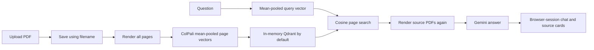

Although the old README used the name MaxSim, the inspected implementation
averaged patch/token embeddings before cosine retrieval. That baseline distinction
matters: the upgrade added actual original-token late-interaction support.

### Upgraded path

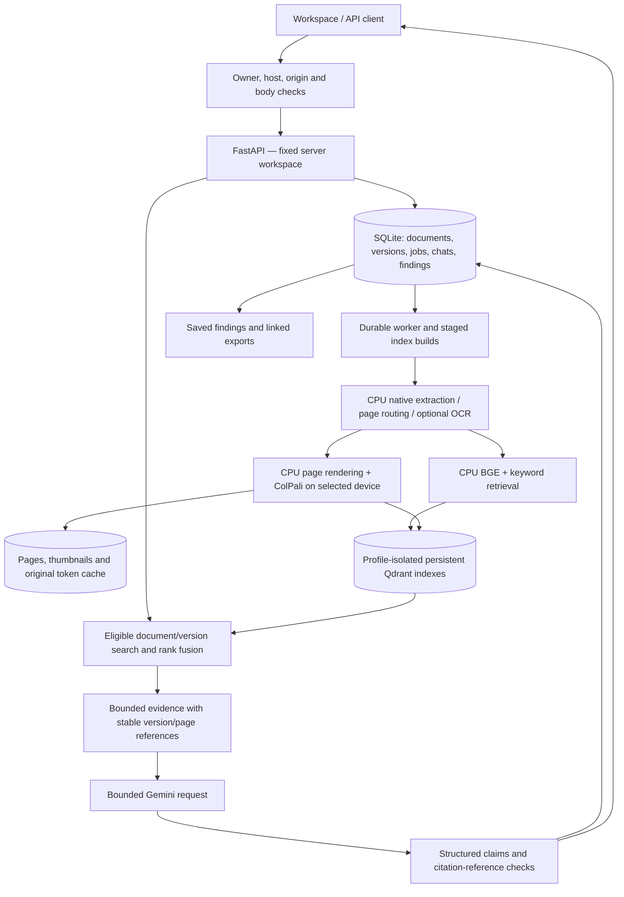

Native extraction and layout signals are retained even when a page takes the
visual path. PDFium rendering is **CPU work**; compatible CUDA accelerates model
inference. One 128-dimensional pooled page vector and a matrix of many
128-dimensional token vectors are different representations and use separate profiles.

## 5. Phase-by-phase implementation

### Phase 1 — make performance bounded and observable

Added direct page counting, single-page rendering, content-addressed lossless
page/thumbnail caches, explicit image/PDF handle cleanup and bounded embedding
batches. PDFium and model locks protect non-thread-safe work; blocking operations
run off the asynchronous request loop. Trace IDs and structured stage timings
separate queue waiting, rendering, loading and inference.

Device/precision selection now reports why an accelerator is unavailable. The
initial CPU-only Torch installation was later replaced with the separate
Windows/Python 3.14 CUDA profile at the user's request. Multi-item OOM work retries
items individually; single-item failure produces an actionable error.

**Benefit:** page previews and counting no longer require rasterizing the whole
document, and inference memory is bounded. Cache population still costs CPU/disk
work; this is not a claim that every operation became faster.

Implementation: [`document_loader.py`](../src/vision_rag/ingest/document_loader.py),
[`colpali_embedder.py`](../src/vision_rag/models/colpali_embedder.py),
[`runtime.py`](../src/vision_rag/runtime.py), [`telemetry.py`](../src/vision_rag/telemetry.py).
Evidence: [Phase 1 results](Validation.md#historical-rendering-and-gpu-checks), [GPU setup](Usage.md#cuda-and-model-setup).

### Phase 2 — make documents and work durable

Introduced SQLite metadata, generated storage keys, content hashes, immutable
versions, deterministic vector identities and disk-backed local Qdrant. Upload
now returns a saved job rather than waiting for all model work to finish.

The worker records progress and supports retry, cancellation, restart recovery
and interrupted-work reconciliation. Replacement publishes a new version only
after its expected work completes; failure preserves the old ready evidence.
Deletion hides a document immediately, then queues retryable cleanup. Originals
and previews resolve through version IDs, not arbitrary client filesystem paths.

**Benefit:** restarting the app no longer means losing the default vector store
or relying on a browser's upload list to reconstruct library state.

Implementation: [`library.py`](../src/vision_rag/storage/library.py),
[`metadata.py`](../src/vision_rag/storage/metadata.py),
[`ownership.py`](../src/vision_rag/storage/ownership.py),
[`qdrant_store.py`](../src/vision_rag/vector_stores/qdrant_store.py).
Details: [Phase 2 guide](Architecture.md#storage-and-jobs).

### Phase 3 — retain text and route difficult pages deliberately

Added native Unicode extraction, quality/layout signals, heading-aware page-local
chunks, persisted routing reasons and revisioned page processing. Tables, charts,
columns, rotations and uncertain text can select additional visual processing.
An optional local Tesseract adapter has a timeout and an explicit fallback when
unavailable. The user can inspect text/routing and queue a durable page override.

**Benefit:** readable native text remains searchable while difficult pages keep
a visual path. The project moved beyond the original all-image/OCR-free claim.
The routing rules are conservative heuristics, not a general table-understanding model.

Implementation: [`ingest/`](../src/vision_rag/ingest/),
[`processing.py`](../src/vision_rag/storage/processing.py).
Details: [Phase 3 guide](Architecture.md#extraction-and-routing).

### Phase 4 — add hybrid retrieval and reference-grounded answers

Added a pinned CPU BGE text encoder and keyword search, original ColPali token
matrices, exact masked MaxSim checks, centroid candidates and original-token
reranking. RRF/Borda experiments and bounded evidence assembly support explicit
source coverage. Retrieval index builds are staged, profile-isolated and
activated only when complete, with recovery and rollback paths.

Generation uses structured claims and supplied evidence IDs. Local validation
rejects unknown references and invalid answer contracts. Insufficient evidence
has an explicit abstention path; follow-up questions retain original and rewritten
forms. Provider deadlines/retries are bounded. Find pages works without a
generation-provider request.

A small learned router was trained on development families separated from the
held-out families. It chooses a starting tier, is experimental and is off by
default. Cached starting-tier comparisons do not measure full escalation cost.

**Benefit:** evidence retrieval can combine searchable text with visual layout,
and the system can identify valid source references. Reference validity does not
independently establish semantic support or numerical correctness.

Implementation: [`retrieval/`](../src/vision_rag/retrieval/),
[`retrieval_models.py`](../src/vision_rag/models/retrieval_models.py),
[`grounding.py`](../src/vision_rag/generate/grounding.py).
Details: [Phase 4 guide](Architecture.md#retrieval-and-grounding).

### Phase 5 — make the evidence workspace persistent and recoverable

Added server-backed conversations, immutable turn scope, persisted results and
ordered events. SSE publishes progress, provisional answer deltas and a final
validated answer. Cancellation/disconnect/restart paths retain clear turn states;
stopping at safe boundaries does not promise instant GPU or provider cancellation.

The evidence viewer preserves the correct version/page, navigation, thumbnails,
zoom and position. Chat reopening, rename/delete, keyboard behavior, safe
text-node rendering and real persisted activity metrics replaced session-only
behavior and illustrative dashboard numbers.

**Benefit:** a user can return to a conversation and inspect what supported an
earlier answer instead of reconstructing it from the current replacement PDF.

Implementation: [`workspace.py`](../src/vision_rag/api/workspace.py),
[`conversations.py`](../src/vision_rag/storage/conversations.py),
[`workspace.js`](../src/vision_rag/static/workspace.js),
[`evidence.js`](../src/vision_rag/static/evidence.js).
Details: [Phase 5 guide](Usage.md#chat-and-evidence).

### Phase 6 — complete an evidence-linked comparison workflow

Added explicit two-to-four-version comparisons and bounded evidence retrieval
per version, preventing one report from consuming the complete evidence budget.
Each requested field/version gets a factual, missing or conflicting cell.
Reported values preserve unit, currency, reporting period and scope.

Saved findings retain immutable content and source manifests, with editable title
and user review status. JSON/CSV/Markdown exports preserve version/page links and
apply access checks and sanitization. Completed chat answers can also become findings.

**Benefit:** a comparison can be inspected, saved, reopened and shared as an
export. A missing cell means the retrieved evidence did not support a value, not
that the entire source document definitively lacks it. Currency conversion and
new calculated metrics are not silently presented as reported facts.

Implementation: [`analysis/`](../src/vision_rag/analysis/),
[`findings.py`](../src/vision_rag/storage/findings.py),
[`API findings`](../src/vision_rag/api/findings.py).
Details: [Phase 6 guide](Usage.md#comparisons-and-findings).

### Phase 7 — evaluate, protect and package the local application

Added optional single-owner token access with revocable HttpOnly cookies and
bearer clients. Authorization covers documents, pages, conversations/events,
findings, exports and OpenAPI. Host/origin/CORS checks, login backoff and request
body limits run before expensive work. Configured credentials are masked in logs
and validation errors avoid echoing raw request input. A follow-up fixed Uvicorn
formatting while preserving that masking.

Offline backup/restore authenticates archives before Qdrant deserialization,
checks paths/hashes/SQLite/originals/vector counts and restores only into a new
directory. Backups are authenticated, not encrypted; model/configuration caches
are excluded and original PDFs support page-cache regeneration.

Added a pinned public ViDoRe V3 subset, a generated CC0 product corpus, real
retrieval runs, provider checkpoints, wheel smoke checks, a pinned container
recipe and source-fingerprint release gates. Dependency fixes reduced the recorded
audit findings, while leaving an unfixed advisory and auditor exclusions visible.

**Benefit:** the local workflow has recoverability and reviewable validation
evidence. A packaged wheel smoke is not proof of a fresh cross-platform install;
container runtime, shared TLS deployment and broad quality gates remain unverified.

Implementation: [`security.py`](../src/vision_rag/api/security.py),
[`backup.py`](../src/vision_rag/backup.py),
[`evaluation runner`](../scripts/evaluate_phase7.py),
[`release checker`](../scripts/check_release.py), [`Dockerfile`](../Dockerfile).
Details: [Phase 7 guide](Usage.md#access-and-deployment), [benchmark](Validation.md#retrieval-results).

### Follow-up — the current workspace redesign

The 8 November redesign made chat the default route, added recent chats and
explicit document chips, kept the source drawer usable, and gave narrow screens
a composer/navigation/source-sheet workflow. The ink-black, cream and burnt-orange
palette, square controls and restrained typography replaced the earlier green,
rounded dashboard presentation.

Readiness checks now report whether selected versions are searchable without
loading a model. Uploading beside the composer saves a document and selects it;
empty scope blocks the next question. Per-chat drafts recover after reload, and
the UI distinguishes failure to upload from failure to select an already-saved PDF.
It does not automatically repeat a failed provider request.

Implementation: [`static/`](../src/vision_rag/static/),
[`workspace readiness API`](../src/vision_rag/api/workspace.py).
Details: [UX guide](Usage.md#chat-and-evidence), [verification](evidence/history.json).

## 6. What the measurements actually show

### Rendering and memory foundations

The Phase 1 eight-page synthetic PDF benchmark compared the historical full-render
approach with bounded operations on the same fixture:

| Operation | Historical median | Upgraded median |
| --- | ---: | ---: |
| Page count | 718.471 ms by rasterizing | 1.108 ms from metadata |
| Page preview | 646.566 ms by rendering all pages | 80.680 ms for one requested page |
| Warm cached preview | No application artifact cache | 69.247 ms |

The full-render preview's recorded peak working set was 353.5 MiB versus 127.2 MiB
for the requested-page case. Batches of two lowered image-buffer pressure, but
populating lossless caches increased first-pass work. These are CPU PDF fixture
measurements, not end-to-end answer latency or a GPU speedup. See the
[raw benchmark](evidence/history.json) and [interpretation](Validation.md#historical-rendering-and-gpu-checks).

### Retrieval after hybrid and MaxSim support

| Phase 7 smoke set | Pooled recall@3 | Text + keyword | Hybrid Borda | Exact visual MaxSim |
| --- | ---: | ---: | ---: | ---: |
| Public: 8 questions / 20 pages | 93.75% | 100% | 100% | 100% |
| Fictional: 16 questions / 18 candidate pages | 75% | 81.25% | 81.25% | 100% |

These figures compare implementations on the same small candidate pools, not
the entire historical product against the new application. The public pool is
gold-enriched and pinned; it is not an official full-corpus ViDoRe score. Hybrid
misses three fictional scan questions that exact visual retrieval finds, so the
upgrade has a measured tradeoff rather than a universal accuracy win.

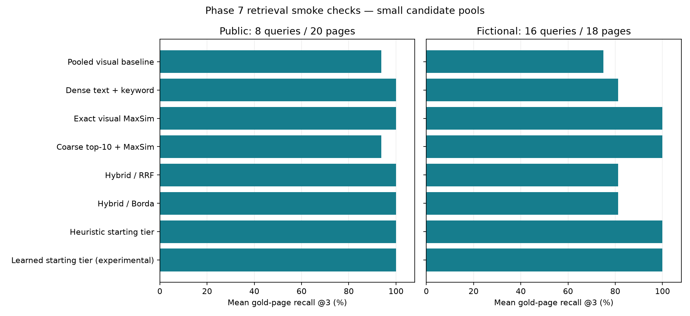

Only the RTX 4050 Laptop was measured. CUDA allocator peaks are not physically
resident VRAM measurements, and the runs do not prove a workload fits a 4 GiB
RTX 3050. First-load, warm-cache and simulated-rerank timings are separated in
the [benchmark report](Validation.md#retrieval-results); no router cost advantage is claimed.

### Verification growth and remaining gaps

The original inspection found six test functions; its README's “10 passed” badge
did not match that count. Four loader/retriever tests passed in the initial
diagnostic run, while that run did not verify the two API tests. We do not turn
the old badge into a measured baseline.

The [8 November verification](evidence/history.json) records **136 Python tests and
four frontend tests passed**, lint/format/type checks and desktop/mobile browser
workflows. Earlier records include real disk/restart checks, backup/search/history
restoration, actual CUDA model checks and an isolated packaged-wheel smoke.

Real provider evidence includes a streamed cited answer (first claim delta about
5.53 seconds, completion about 5.57 seconds) and fictional comparisons. The Phase 7
prompted-router checkpoint contains 20 of 24 routes; product-answer checks contain
one of five tasks before HTTP 503 interruptions. These are historical records,
not a statement about current provider uptime. They can resume without repeating
completed samples. Usage is recorded where supplied; dollar cost is unknown.

No independent semantic-support study, representative abstention assessment or
human time-to-verify study was completed. Mocked UI inference is not evidence
that a real model answers accurately. See [provider records](evidence/phase7-provider.json),
[product answers](evidence/phase7-answers.json) and [recorded gates](evidence/phase7-release-gates.json).

## 7. Changes developers and existing users need to know

| Old assumption | Current contract / operational change |
| --- | --- |
| Upload finishes only after indexing | `/api/v1/ingest` returns HTTP 202 and a durable job; poll it and search readiness |
| Filename identifies the evidence | Use document/version IDs; display filenames are metadata |
| Restart loses the default vector collection | `QDRANT_MODE=local` persists embedded Qdrant and SQLite under `DATA_DIR` |
| `QDRANT_IN_MEMORY` switches storage | The legacy setting no longer selects it; use `QDRANT_MODE` |
| Every ready PDF is immediately searchable in any profile | Search requires eligible completed builds and a compatible active index |
| Deleting a file is enough | Deletion hides evidence and queues metadata/vector/artifact cleanup |
| Chat history is browser-only | Persisted conversations/turns are server-owned; unsent drafts remain tab-local |
| Every question searches the whole library | Current chat requires explicit source selection; each turn retains its scope |
| Source cards refer to whatever PDF has that name | Citations resolve retained immutable versions and pages |
| `/docs` is the startup check | Use `/health` for liveness and authenticated OpenAPI JSON for schemas; CSP can block Swagger assets |
| A normal `uv run` preserves custom CUDA packages | Use `.venv` Python or `uv run --no-sync` after applying the CUDA overlay |
| Multiple web processes can share the local directory | One process owns a library; additional instances need separate data directories |

For an existing installation, back up data first, keep `.env` and originals, and
follow the phase-specific migration guidance. Metadata migrations and legacy
reconciliation are implemented, but old vectors are not assumed compatible with
new model/index profiles. Rebuild through Processing & search when required and
confirm readiness before asking questions. Do not delete the original library
merely because a restore command succeeded; inspect the restored copy first.

Current startup, configuration and API examples are in the [README](../README.md).
The [Phase 7 guide](Usage.md#access-and-deployment) covers backup, owner access and packaging.

## 8. What is deliberately not claimed complete

- Multi-user RBAC, invitations and tenant administration.
- Verified shared TLS deployment, container runtime or Linux GPU distribution.
- Broad multilingual OCR accuracy, representative answer correctness and
  independent semantic support.
- Complete prompted-router/product-provider runs after the recorded service errors.
- Measured RTX 3050/other-system performance or verified account dollar costs.
- A clean security audit: the recorded audit retains an Accelerate checkpoint
  advisory and skips CUDA wheels. Only trusted pinned model files should be loaded.
- Automated numerical calculations, currency normalization, region QA, version
  diffs or retrieval similarity maps as shipped analytical features.

The release checker intentionally fails closed for missing evidence or stale
source fingerprints. Its historical green local checks do not approve later
source changes automatically. The [feature matrix](Validation.md#feature-status) separates
implemented, experimental, planned and unverified work.

## 9. Where to inspect the implementation

| Responsibility | Main location |
| --- | --- |
| HTTP and fixed-workspace wiring | [`api/`](../src/vision_rag/api/) |
| Durable library, metadata and ownership | [`storage/`](../src/vision_rag/storage/) |
| Page extraction, OCR, routing and rendering | [`ingest/`](../src/vision_rag/ingest/) |
| Model adapters and pinned encoders | [`models/`](../src/vision_rag/models/) |
| Retrieval builds, eligibility, fusion and MaxSim | [`retrieval/`](../src/vision_rag/retrieval/) |
| Grounding contracts and answer events | [`generate/`](../src/vision_rag/generate/) |
| Evidence-linked comparison | [`analysis/`](../src/vision_rag/analysis/) |
| Workspace, document selection and evidence viewer | [`static/`](../src/vision_rag/static/) |
| Routine and disposable browser checks | [`tests/`](../tests/) |
| GPU, quality, packaging and release runners | [`scripts/`](../scripts/) |

The detailed [decision log](Architecture.md#design-decisions) explains tradeoffs, the
[implementation plan](README.md#current-status) tracks scope, and the
[current README](../README.md) describes how to run the resulting application.

## 10. Luminous project entry and workspace — 9 November

The project now opens on a separate About Project landing page, following the
approved dark emerald design. Explore Vision enters `/workspace`; project
sections remain separate from saved chats and owner data. A matching luminous
workspace adds clear Ask Vision / Find pages controls and a searchable document
table with real readiness states. Comparisons retain reported context rather
than adding unimplemented calculated differences.

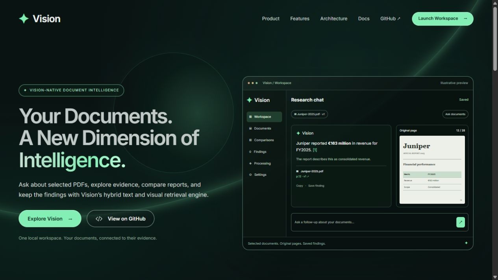

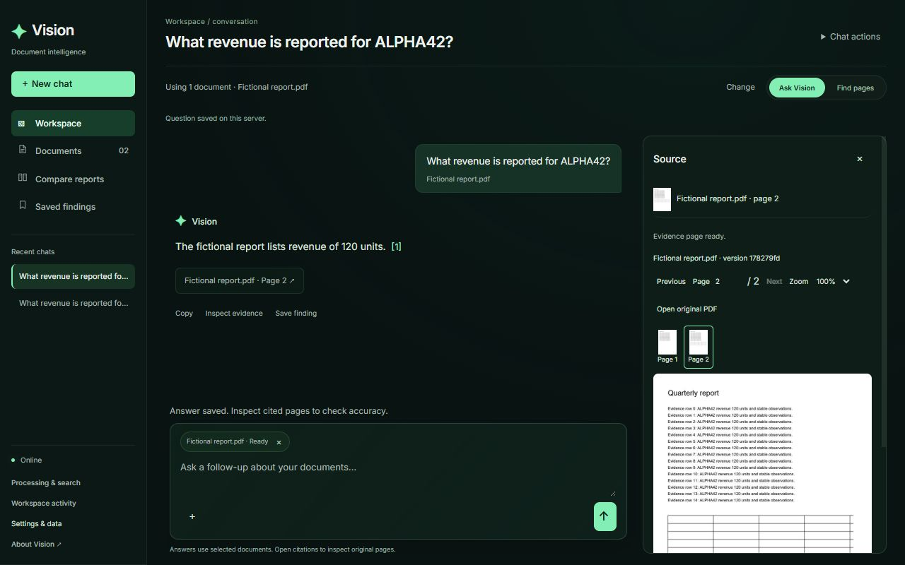

The earlier screenshots above document the 8 November interface. The new browser
captures use generated fictional PDFs and simulated inference. See
[Validation](Validation.md#recorded-checks) for the 138 Python / seven frontend
passing checks and [Usage](Usage.md) for the updated entry flow.

## 11. Compact header and darker surfaces — 9 November

Restored Dashboard, Upload, Chat and Documents to a compact top navigation bar,
with Compare and Findings beside them. Recent chats moved into the chat toolbar;
Settings holds data controls and About Vision. Black and charcoal surfaces replace
the broad green treatment, while green accents and luminous progress remain.
The public project page retains its separate Explore Vision entry.

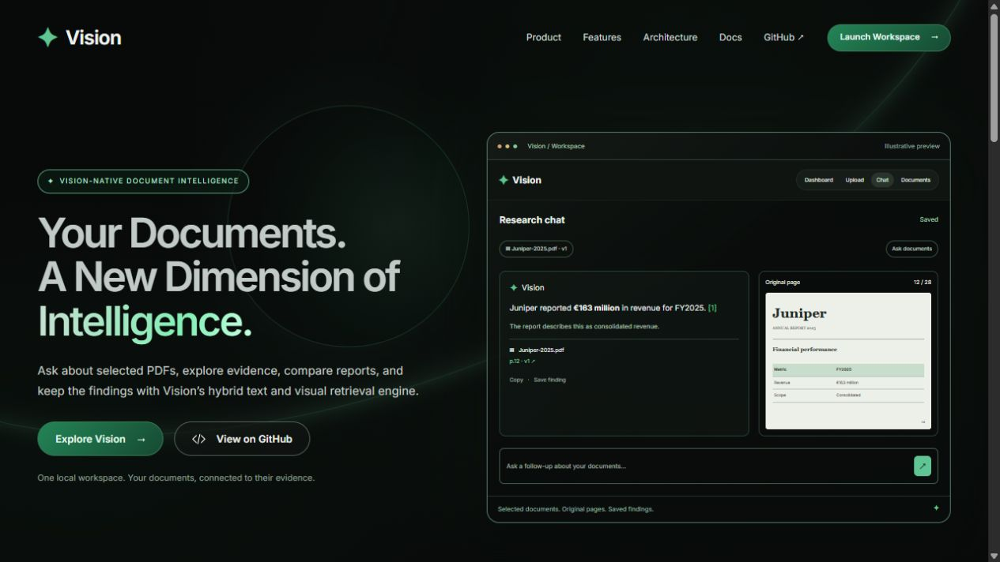

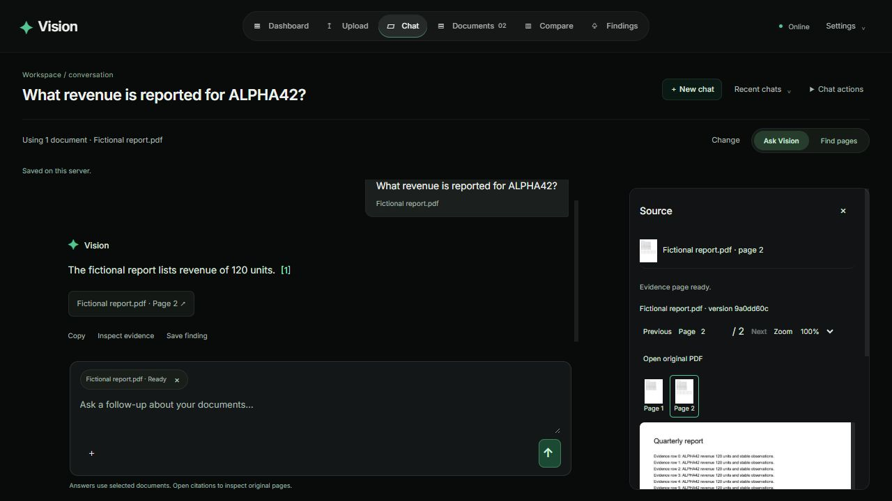

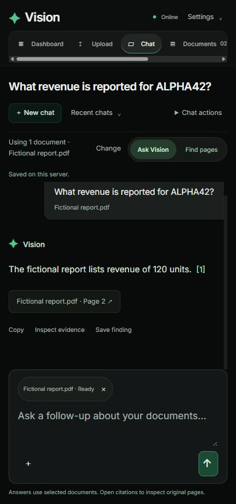

This follow-up also restores mobile navigation after leaving a source sheet and
handles remembered findings that no longer exist. See the follow-up record in
[Validation](Validation.md#recorded-checks).

## 12. Product landing and interactive walkthrough — 9 November

Rebuilt the About Project page around the supplied reference: centered cream
serif headline, compact navigation, black surfaces, a focused emerald glow and
a detailed product window. The public example now walks through a dashboard,
PDF preparation, a cited answer and the document library. Its fictional data is
explicitly labeled, and all example interactions stay local to the page.

The workspace keeps its compact header. Fresh chats now show useful starter
tasks and an explanation of the workflow; first-question placeholders and scroll
position reset when opening a new chat.

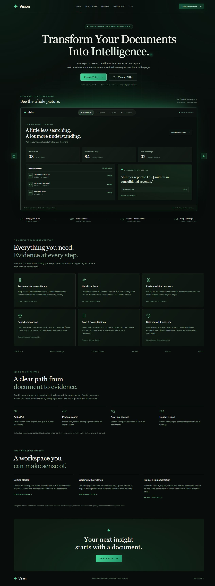

See [Usage](Usage.md) for walkthrough controls and
[Validation](Validation.md#recorded-checks) for the checks on this revision.

## 13. Animated architecture wireframe — 11 November

Added an original SVG system map to the landing page's Architecture section.
PDF versions branch into native text and visual pages, converge on complementary
search indexes and ranked evidence, then lead to grounded answers, comparisons
and saved findings. Separate paths show local Find pages and retained original
page references. Moving packets, scanning and illuminated vector cells explain
the connections without a video asset or animation dependency.

The six selectable stages include explanations and technology labels. Pause/play,
offscreen suspension, reduced-motion support and contained mobile panning keep
the illustration inspectable. It is explicitly illustrative, not live processing.

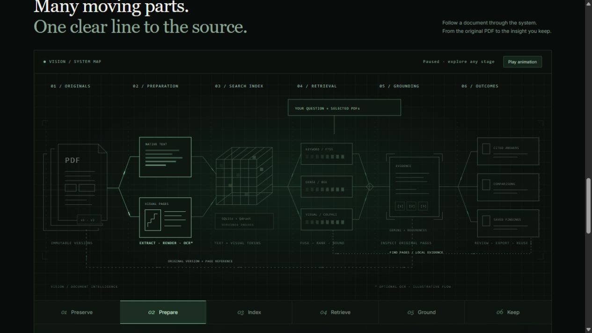

See [Usage](Usage.md) for controls and [Validation](Validation.md#recorded-checks)
for the source-hashed verification record and mobile capture.

## 14. Charcoal theme and useful dashboard — 12 November

Moved the architecture animation directly below the hero. Removed the green
surface treatment across the landing, wireframe and owner workspace in favor
of charcoal backgrounds and cream text, controls and motion. The composition
takes inspiration from [Isoquant](https://isoquant.ai/) and
[ArtCraft](https://getartcraft.com/apps) while retaining Vision's original diagram.

The dashboard now surfaces persisted library readiness, preparing/attention
states, completed-question and saved-finding totals, recent conversations, ready
PDFs and findings. Ask, Resume and Open go to the selected record. Clear empty
and unavailable states replace illustrative activity, with refresh limited to
the visible dashboard and explicit actions.

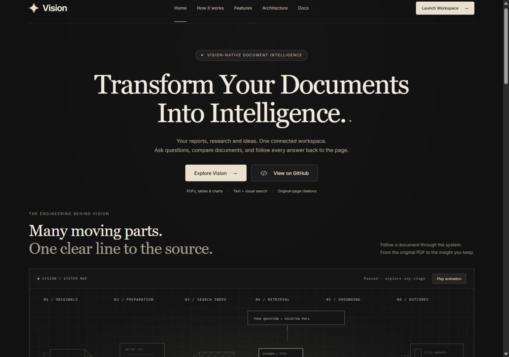

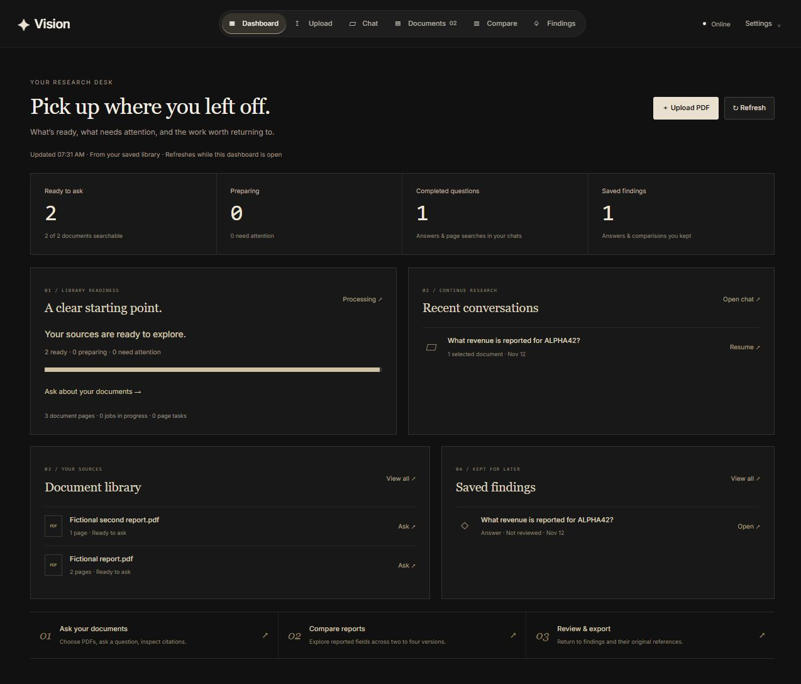

See [Dashboard usage](Usage.md#dashboard) and
[Validation](Validation.md#recorded-checks) for full-suite and browser evidence.

## 15. Hero simulation and conversation reader — 12 November

Added an original document-to-citation simulation to the hero, retaining charcoal
surfaces and cream typography. The fictional example combines a scanned-page
effect, text/visual signal paths, an embedding wireframe and an answer with its
source. Motion supports pause, reduced motion and visibility suspension.

Workspace now has a visible Home link. Chat has a larger reading canvas, a
focused composer and a broad evidence split. Readers can expand, fit the page or
width, navigate pages and return with Escape; mobile uses a full-screen reader.

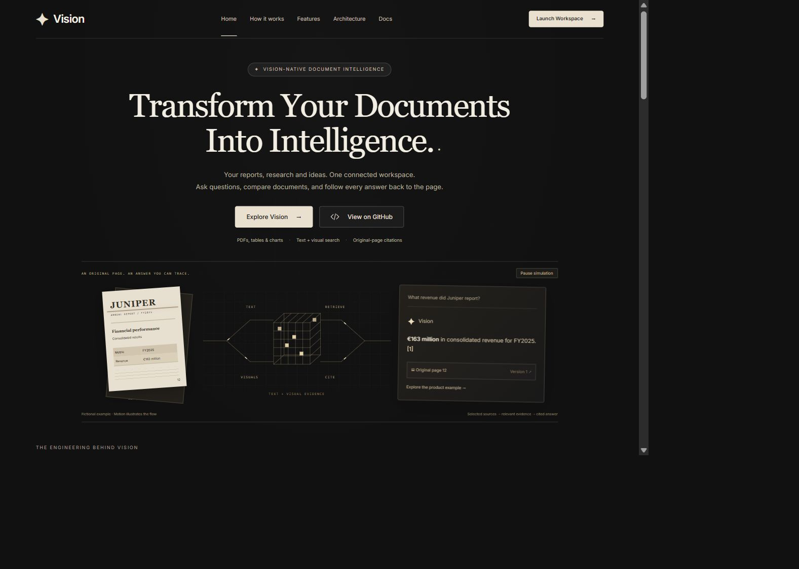

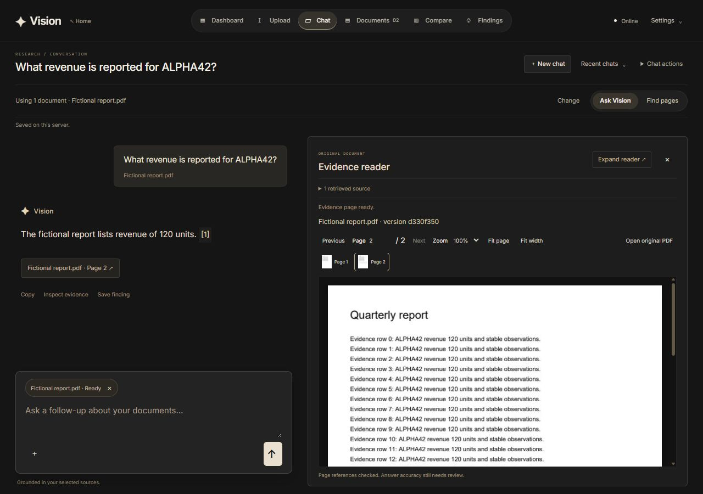

See [recorded checks](Validation.md#recorded-checks) for the 163 Python and
26 frontend test results and isolated browser verification.
