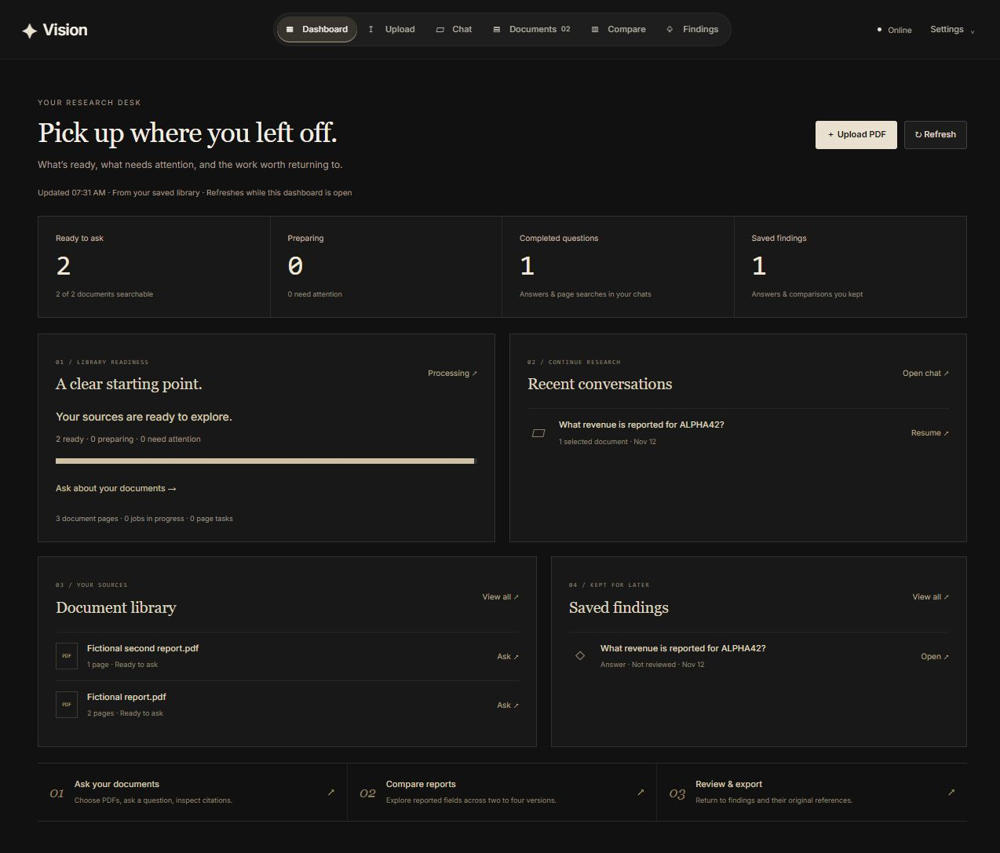
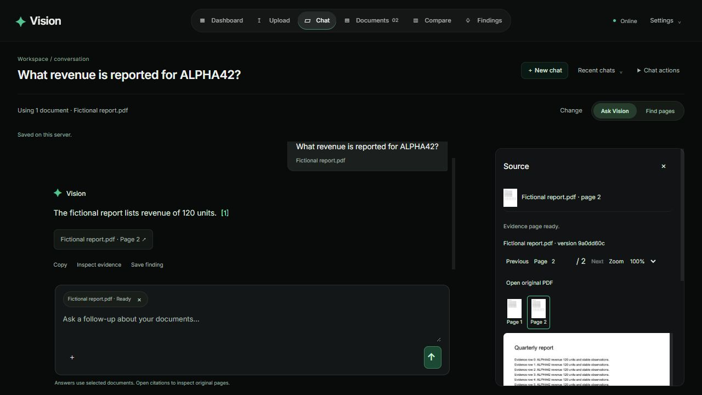
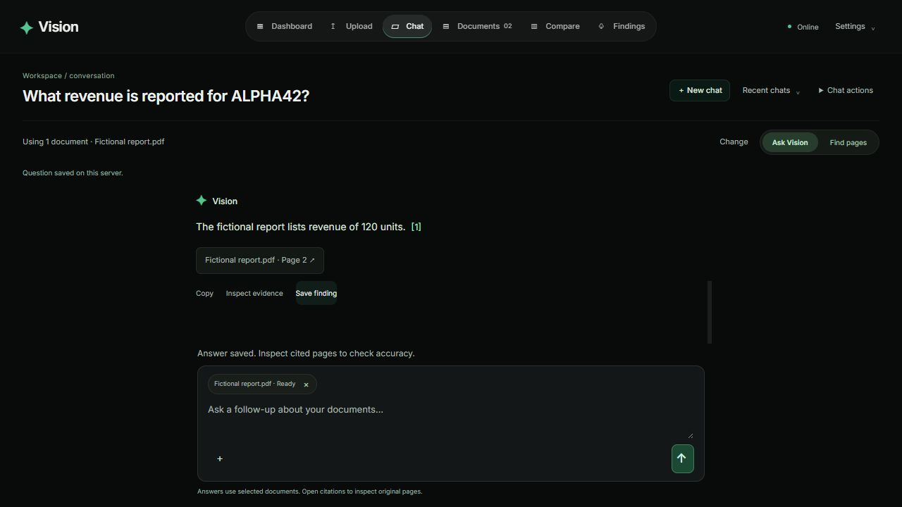
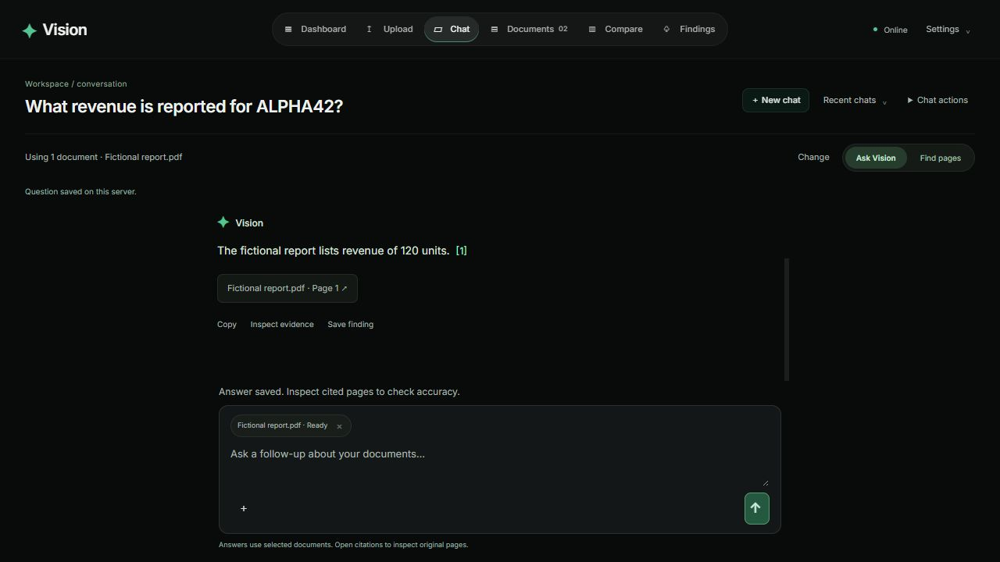
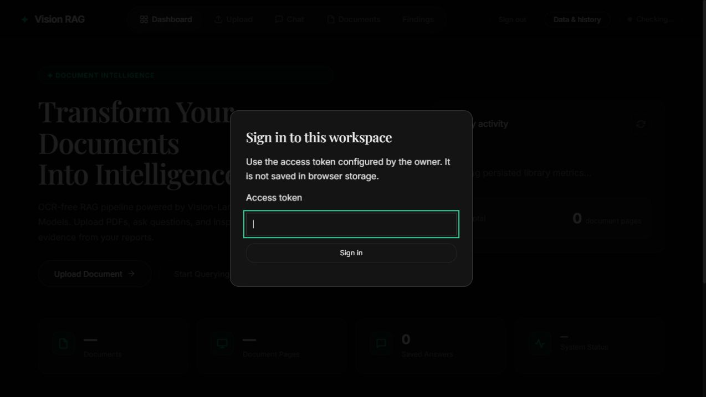

# Setup and everyday use

Consolidated 9 November 2026. This guide replaces the separate GPU, workspace,
data-controls and operational phase guides. See [upgrade history](Upgrade%20history.md)
for the original version and phase-by-phase changes.

## Install and start

The named verified environment is Windows/Python 3.14 with an RTX 4050 Laptop.
Other supported-in-code platforms need separate validation. For a fresh checkout:

```powershell
uv sync --frozen --extra dev
if (!(Test-Path .env)) { Copy-Item .env.example .env }
```

Set your private `GOOGLE_API_KEY` and a generation model available to your account.
Ingestion and Find pages do not require a generation-provider call. Both still
need the relevant local model files. First model use may download pinned snapshots.
Use [.env.example](../.env.example) for settings and [README](../README.md#api) for API examples.

```powershell
.\.venv\Scripts\python.exe -m vision_rag.api.main
```

Open http://127.0.0.1:8000. If it is occupied, use the existing server or a
different `BIND_PORT`. Every simultaneous server needs a separate `DATA_DIR`.
One process owns each local SQLite/Qdrant library. On other platforms the Python
executable is normally `.venv/bin/python`.

The root URL opens the public **About Project** landing page. Choose **Explore
Vision** or **Launch Workspace** to enter `/workspace`. The project page explains
features and architecture without requesting library or session data. The
workspace retains owner sign-in when configured. **Settings → About Vision**
returns to the project page; existing root `#chat`/`#documents` bookmarks redirect
to the equivalent workspace section.

The landing page's **How it works** section is an interactive demonstration.
Use its Dashboard, Upload, Chat and Documents tabs to explore the workflow;
arrow keys, Home and End also switch tabs. The example uses fictional Juniper
reports. Clicking its citation highlights the example original page. Upload your
own PDF and workspace links enter the real application; the public demonstration
never loads your library. New workspace chats offer starter questions and the
three-step path from document selection to inspecting and saving evidence.

Directly below the hero, the landing page's **Architecture** section contains an original animated
wireframe of the complete document-to-evidence flow. Its six stages are Preserve,
Prepare, Index, Retrieve, Ground and Keep. The guided tour advances automatically
while visible; choose any stage to pause and read its explanation, or use
**Pause animation / Play animation**. On smaller screens the drawing scrolls
inside its own panel, and selecting a stage brings that module into view.
Panning pauses the tour. Reduced-motion preferences show a static, selectable
diagram. This public illustration does not process documents or fetch owner data.

## Dashboard

The Dashboard is a research desk backed by your persisted library. It shows
searchable documents, documents still preparing, completed questions and saved
findings. Readiness separates preparation from issues needing attention; a
successfully uploaded PDF is not treated as searchable until its index is eligible.
Use **Ask** beside a ready PDF to start a chat with that source selected,
**Resume** to reopen a specific conversation, or **Open** to inspect a saved
finding. Processing and library links lead to the corresponding workspace views.

Counts refresh on entry, with **Refresh**, and periodically while the dashboard
is visible. Failed requests show unavailable sections and unknown totals as **—**;
empty libraries show starting actions. Public landing examples remain fictional;
the owner dashboard uses real saved data. All surfaces use charcoal with cream text.



## CUDA and model setup

For the measured Windows/Python 3.14 profile, stop processes using this environment
before replacing loaded Windows libraries, then apply the pinned CUDA overlay:

```powershell
uv pip install --python .venv/Scripts/python.exe -r requirements/cuda-windows-py314.txt
.\.venv\Scripts\python.exe scripts/check_gpu.py
```

The documented profile uses Torch 2.13.0+cu130, TorchVision 0.28.0+cu130 and visual
batch size 1. This is not a universal hardware recommendation. Rendering uses CPU
PDFium; ColPali inference can use CUDA. `auto` selects CUDA, then MPS, then CPU.
Use the environment Python directly or `uv run --no-sync` afterward: normal syncing
can replace the CUDA build. The overlay does not replace the platform-neutral lock.

`MODEL_WARMUP=true` loads local encoders at startup; it does not validate Gemini.
Keep it false for lighter startup. `/health` is liveness, not provider or index
readiness. Diagnostics and selected-document readiness answer different questions.

OCR is optional. Configure `TESSERACT_EXECUTABLE`, `OCR_LANGUAGE` and its timeout
for your installed local Tesseract. Missing/failed OCR records a warning and retains
a visual fallback. Downloaded models/OCR runtimes are not deleted by library reset.

## Chat and evidence

The workspace uses a compact header: **Dashboard → Upload → Chat → Documents →
Compare → Findings**. Charcoal surfaces use cream text, controls and motion
highlights. The header scrolls horizontally on narrow screens. **Recent chats** and
**New chat** live in the chat toolbar; **Settings** contains Data & history and
the return to About Vision. Luminous type marks active processing.

**Ask Vision** and **Find pages** sit beside document selection. Documents uses a searchable
table with status filters and a per-document action menu. On narrow screens the
table scrolls inside its own panel, preserving readable columns and page width.

1. Start or reopen a chat. Upload a PDF beside the composer or choose library PDFs.
2. Wait for the selected versions to become searchable. New search snapshots are
   prepared automatically; Processing & search exposes progress and index controls.
3. Select up to six explicit documents. Removing the final chip blocks submission;
   it never silently broadens the next question to the whole library.
4. Enter sends; Shift+Enter adds a line. Find pages retrieves locally without
   generating an answer. Stop requests cancellation at the next safe boundary.
5. Open a citation for the original version/page. Desktop uses a drawer; mobile
   uses a separate source sheet. Navigate, zoom or open the original PDF.
6. Save a useful completed answer as a finding.



Every submitted turn retains its source set. Saved conversations and events are
server-owned. Unsent drafts are saved per chat in browser-tab session storage;
access tokens are not stored there. Accepted questions clear only after server
acceptance. Failed selection saves keep the picker open; already-saved uploads are
distinguished from selection failures. Temporary full-answer failures use bounded
server-side recovery; a submitted question is not duplicated in conversation history.

Draft recovery is tab-local, not a cross-device sync feature. Cancellation may wait
for an in-flight GPU/provider boundary. Reduced-motion/forced-color fallbacks and
keyboard focus behavior are implemented; broad accessibility approval is not claimed.

## When answers time out or the provider is unavailable

An HTTP 503 from Gemini or a provider read timeout is different from a missing
local search index. The failed turn is kept with an actionable error; provisional
text is not published as a validated answer. Find pages remains provider-free.

New chats and ordinary UI retries now use the complete-response path by default;
users should not need a failed streaming attempt first. SSE still delivers progress
and the final saved answer. API clients can explicitly opt into provider streaming
with `stream_answer: true`; `/query` remains a non-streamed request.

`PROVIDER_ATTEMPTS` is the total attempt budget for each provider adapter call
(default two, maximum three). Temporary timeouts, connections and selected server
errors use cancellable backoff. The SDK itself makes only one attempt, avoiding
multiplied retry loops. A partial opt-in stream is never automatically replayed.
Semantic retrieval escalation is a separate bounded generation step; the attempt
budget is not a guaranteed total question deadline or a promise of zero provider cost.

Only identified short per-minute limits with a provider delay of at most 30 seconds
are retried. Daily quota, key/model permission and invalid-request errors require
the appropriate account/configuration fix. When a daily quota includes a reset
delay, the current client remembers it and avoids more provider calls until then.
That hold is in memory; restart or a different model/client learns its own quota.

This is an alternative transport path, not a bypass for quotas or unavailable
models. Retry later for service errors, check model/key permissions for access
errors, and try fewer documents for slow requests. Administrators can explicitly
increase `PROVIDER_TIMEOUT_MS` (default 30000, maximum 120000) for genuinely slow
requests; that does not fix HTTP 503 or quota exhaustion. Restart after changing
configuration. An in-flight provider call may still finish before cancellation.

Both recovery and the newer first-attempt full-answer default were checked in
disposable browser libraries with fictional documents and simulated providers:





## Comparisons and findings

Compare reports takes two to four explicit retained versions and one to eight
distinct fields. A version can be older than the current replacement when its
eligible index is retained. Each field/version produces a reported, missing or
conflicting cell. Inspect citations and check unit, currency, period and scope.

Missing means the retrieved evidence did not support a value, not that the entire
PDF lacks it. No silent currency conversion or new calculated metric is presented
as a reported fact. User review status is personal review, not semantic proof.

Findings retain immutable answer/table/source content and hashes. Titles/review
flags can change; a new comparison creates a new result. Save drafts explicitly,
reopen saved findings and export JSON, CSV or Markdown. Source access/deletion
checks still apply to exports. Comparison requests are bounded synchronous
provider operations, separate from chat SSE streaming/cancellation.

## Data controls

Open Settings & data. These operations are different:

| Action | Removes | Preserves |
| --- | --- | --- |
| Clear history | Conversations, turns/events, draft comparisons and displayed history | Saved findings, PDFs, versions, indexes, active jobs |
| Clear page cache | Managed derived page, thumbnail and token artifacts | Originals, text/indexes, chats and findings |
| Start fresh | Managed library data, vectors, jobs, conversations and findings | Configuration, credentials, model/OCR downloads and unrelated files |

Start fresh requires typing `DELETE` and is permanent. It is not forensic secure
erasure. Other open tabs are notified to clear history/reload where appropriate.
Reset uses a durable marker to hide evidence and block new work while cleanup
runs; interrupted/failed cleanup remains hidden and can be retried. Mixed-workspace
or unsupported server-mode resets are rejected. Unknown unrelated files are kept.

`GET /api/v1/maintenance` reports support/pending state. POST accepts `action`
(`history`, `cache`, `reset`) and `confirmation` (`CLEAR`, or `DELETE` for reset).
Maintenance is subject to the same configured owner boundary as other API routes.

## Backup and restore

Stop the application. Back up a persistent embedded-Qdrant library outside itself:

```powershell
.\.venv\Scripts\python.exe -m vision_rag.backup keygen backups/library.key
.\.venv\Scripts\python.exe -m vision_rag.backup create data backups/library.zip --key-file backups/library.key
.\.venv\Scripts\python.exe -m vision_rag.backup restore backups/library.zip restored-data --key-file backups/library.key
```

Create refuses a running library/existing archive. Restore requires a new target,
authenticates the manifest before extraction/Qdrant deserialization, then checks
paths, hashes, expansion limits, SQLite, originals and vector counts. Default
expansion limits are 8 GiB and 100,000 files. Qdrant local persistence uses pickle;
open only authenticated archives from your own trusted backup process.

Keep the key separately with restricted filesystem access. Authentication is not
encryption; archives contain library content. Lost keys cannot authenticate a
restore. Configuration, API keys, model downloads and regenerable page caches are
excluded. Start the restored copy using `DATA_DIR=restored-data`, inspect it, and
keep the old library until verification succeeds.

## Access and deployment

Loopback local mode is anonymous by default. Set a private random `ACCESS_TOKEN`
of at least 32 characters and restart to enable owner sign-in. Browser sessions use
random HttpOnly/SameSite Strict cookies; API clients use bearer authorization.
Logout revokes that session for subsequent requests, and restart revokes all
browser sessions. Rotate the configured owner token and restart to replace it.

Authorization protects search, originals, previews, events, findings, exports and
OpenAPI. Static assets, health and session entry points remain public. This is one
owner and a fixed server workspace, not multi-user RBAC. Host/origin/body checks,
login backoff, CORS restrictions and credential masking supplement the boundary.
Strict CSP may block Swagger/ReDoc assets; use authenticated OpenAPI JSON instead.

Non-loopback configuration requires authenticated mode, explicit hosts, secure
cookies, trusted proxy IPs and TLS. Plain HTTP network API access is rejected.
This guardrail is not a verified shared deployment profile. The pinned Docker CPU
recipe has not been runtime-verified; it binds container loopback. Ordinary port
forwarding does not make that a supported deployment. The optional Qdrant compose
service is separate from the default embedded store and binds localhost.

## Existing libraries and upgrades

The retained owner sign-in screenshot is a historical Phase 7 fixture, before
the later visual redesign; it demonstrates the sign-in boundary rather than the
current workspace styling:



Preserve `.env` and originals, stop the owner process and back up before migrating.
Metadata migrations and legacy PDF reconciliation run at startup. Root-level
legacy PDFs are validated, copied to generated keys and queued once; a migration
ledger prevents deleted legacy documents from reappearing. Changed legacy files
must be uploaded explicitly. Invalid/conflicting files remain on disk for inspection.

Old vectors are not trusted as compatible with a new model/profile. Wait for
eligible search builds or rebuild through Processing & search. Failed replacements
keep prior ready evidence; activating an index revision does not restore deleted
documents or roll back original PDF versions. See [Architecture](Architecture.md)
for consistency/retention contracts and [Validation](Validation.md) for measured limits.

If you explicitly configured `ROUTER_PATH` to the former `Docs/phase4-router.json`,
update that path to `Docs/evidence/phase4-router.json`. This only relocates the
experimental artifact; its 150-DPI profile is still incompatible with a default
300-DPI index. No local `.env` values were changed by the documentation cleanup.
