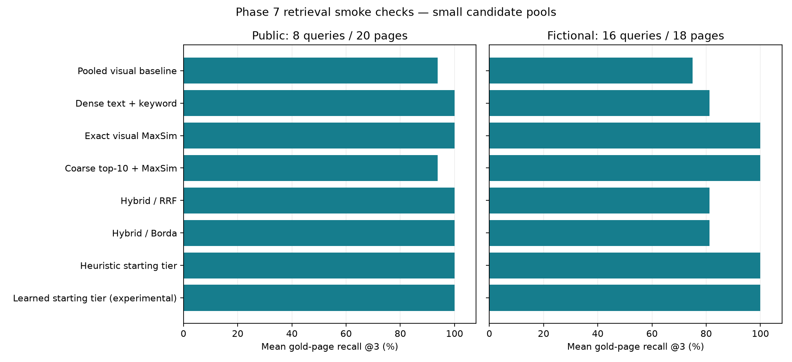

# Validation and release evidence

Consolidated 9 November 2026. This replaces separate benchmark, feature-matrix,
verification and release guides. No new model/provider measurements were made
as part of reorganizing documentation. Historical evidence remains historical.

## Recorded checks

The 8 November workspace run recorded 136 passing Python tests, four frontend
tests, lint/format, strict typing of 44 source files, compilation and desktop/mobile
browser checks. Those browser fixtures use fictional PDFs and simulated inference.
Their source hashes and limits are retained under `records["ux-verification.json"]`
in [historical evidence](evidence/history.json). They are not real-provider quality approval.

The original inspection found six tests, not the old README badge's ten. Initial
diagnostics verified four loader/retriever tests; the two API tests were unverified
in that run. Phase 7 later recorded 133 passing tests and an isolated wheel smoke;
the workspace follow-up brought the recorded suite to 136.

Phase 7 [verification](evidence/phase7-verification.json) and
[wheel record](evidence/phase7-wheel.json) describe their recorded revisions.
Code changes afterward make source-fingerprint validation stale. No fresh release
approval follows from moving these records.

## Retrieval results

Recorded on the RTX 4050 Laptop; local smoke experiments, not an official benchmark or production approval.

## Retrieval relevance

| Policy | Public recall@3 | Public complete coverage@3 | Internal recall@3 |
| --- | ---: | ---: | ---: |
| Pooled visual baseline | 93.75% | 87.50% | 75.00% |
| Dense text + keyword | 100.00% | 100.00% | 81.25% |
| Exact visual MaxSim | 100.00% | 100.00% | 100.00% |
| Coarse top-10 + MaxSim | 93.75% | 87.50% | 100.00% |
| Hybrid / RRF | 100.00% | 100.00% | 81.25% |
| Hybrid / Borda | 100.00% | 100.00% | 81.25% |
| Heuristic starting tier | 100.00% | 100.00% | 100.00% |
| Learned starting tier (experimental) | 100.00% | 100.00% | 100.00% |



Public: eight English questions, 20 pages, two OpenStax books from [ViDoRe V3 computer science](https://huggingface.co/datasets/vidore/vidore_v3_computer_science), revision `d5cc75883d92e294f0c0fc2662551c9708a06ebc`. CC-BY-4.0; attribution: ViDoRe V3 contributors and OpenStax textbook authors. Selection is fixed before inference: first eight English queries with one to three positive pages, all gold pages plus eight fixed corpus-ID distractors. This gold-enriched pool is much easier than full-corpus retrieval. Scores are not official ViDoRe results.

Internal: 16 questions over 18 candidate pages from generated Juniper, Basalt and Granite reports. Includes numbers, identifiers, tables, charts, image-only scans and sampled pages from a 64-page PDF. All versions of these families are held out from Phase 4 router training. Related versions occur together only inside the held-out product split. The corpus is synthetic and template-based; its results do not establish generalization.

Both runs use identical candidate pages for all policies, 150 DPI, pinned BGE/ColPali revisions and original token matrices. Text uses native extraction without OCR in this experiment. Exact scoring runs locally in NumPy; coarse reranking is simulated from cached exact scores and is not a latency optimization measurement. Learned and heuristic rows choose starting tiers without generation/escalation; the unmodified synthetic router is evaluated out of domain and remains disabled in normal use.

Coarse candidate recall@10: public 93.75%; internal 100.00%. The public coarse stage drops relevant evidence. Hybrid improves over pooled retrieval here, but loses three internal scan queries that exact visual retrieval finds. No policy is declared best for general use, and no router cost win is claimed.

## Timing and memory

| Measurement | Public | Internal |
| --- | ---: | ---: |
| Warm dense encoding + scoring (mean, queries 2+) | 39.52 ms | 32.41 ms |
| Warm visual query encoding (mean, queries 2+) | 65.18 ms | 56.86 ms |
| Exact scoring over candidate tokens (mean) | 15.22 ms | 12.10 ms |

Timing excludes provider generation, database filtering and most application work; text timing also excludes keyword fusion. First query visual encoding can include lazy model loading; inspect raw samples. Cached subset preparation is not cold ingestion throughput. The separate [uncached internal run](evidence/history.json) prepared 18 pages in 117.78 seconds including model loading (0.153 pages/s), outside the durable application ingestion pipeline. It measured a peak CUDA allocator value of 8.71 GB and process RSS of 4.47 GB. CUDA allocator bytes are not a measurement of physically resident VRAM; the laptop has about 6 GiB of GPU memory and Windows may oversubscribe it. This does not prove the workload fits a 4 GiB card.

Original float32 tokens occupy about 1.06 MB/page before compression; compressed token files are about 0.305 MB/page. These are token-only storage figures, excluding PDFs, page caches, indexes and SQLite. Hardware, Torch/CUDA versions, exact profiles, source hashes and per-query results are in [public](evidence/phase7-retrieval.json) and [internal](evidence/phase7-internal.json) records. Only the RTX 4050 Laptop is measured; RTX 3050 and other systems are unmeasured.

## Answer quality and provider cost

The real streaming check passed: first provisional claim delta 5.53 s, completion 5.57 s. This is adapter latency, not browser TTFT. A supplied-gold version-comparison sample correctly reported 137 and 163 million EUR with valid references. Remaining product checks and the prompted router baseline stopped on HTTP 503; inspect the checkpointed [provider](evidence/phase7-provider.json) and [answers](evidence/phase7-answers.json) reports. Resume scripts skip completed requests and stop at the first new error.

Token usage is recorded where supplied by the provider. Dollar cost is unknown, not zero; no verified account billing rate is available. Phase 4's [cost/quality comparison](assets/phase4-cost-quality.png) remains a synthetic cached-tier experiment. Partial prompted routes are not compared against full test-set means. Independent semantic support, representative answer correctness/abstention and human time-to-verify are unmeasured. Routine contract and browser tests do not fill those gaps.

## Historical rendering and GPU checks

The eight-page Phase 1 CPU fixture measured page counting at 718.471 ms by
rendering versus 1.108 ms from metadata. Full-render previews measured 646.566 ms
versus 80.680 ms for one requested page and 69.247 ms for a warmed page artifact.
Preview process peaks were 353.5 MiB versus 127.2 MiB for the single-page case.
Lossless cache population increased first-pass work; these are not end-to-end
answer speedups. See the original `phase1-benchmark.json` payload in history.

The later CUDA smoke recorded model initialization at 19.188 s, first/subsequent
page embeddings at 7.246/3.926 s and first/subsequent queries at 0.191/0.045 s.
It used cached weights, a synthetic page and no Gemini request. Supporting
metadata access needed network access; fully offline loading was not established.
Allocator peaks exceeded physical VRAM; success does not imply full residency.

The history bundle preserves the original GPU/initial GPU, OCR, Phase 1/3,
Phase 4 model/provider, Phase 5/6 workflow and uncached Phase 7 reports. The OCR
record is an English scan smoke, not broad language recognition evidence.
Payloads are keyed by original filename so dates and details are not silently rewritten.

## Feature status

| Capability | State | Validation / limit |
| --- | --- | --- |
| CPU page rendering, caching, bounded GPU embedding | Implemented | Real RTX 4050 checks; rendering itself is CPU |
| Durable documents, immutable versions, worker jobs | Implemented | Disk/restart/failure tests; one local process |
| Native text, selective OCR and visual fallback | Implemented | English scan smoke; broad language quality unverified |
| BGE text + keyword retrieval | Implemented | Pinned model; routine and real subset checks |
| Original-token MaxSim, rank fusion, coarse reranking | Implemented | Exact scoring checks and measured retrieval subsets |
| Learned starting-tier router | Experimental, off by default | Synthetic training; cross-domain smoke; no proven cost win |
| Grounded claims, citation reference checks, abstention contract | Implemented | References checked; independent semantic support unverified |
| Conversations, ordered answer events, evidence pane | Implemented | Browser fixtures plus one real streaming-adapter check |
| Comparison, findings, JSON/CSV/Markdown exports | Implemented | Workflow/browser tests and fictional provider checks |
| Owner sessions and fixed workspace authorization | Implemented | HTTP tests and isolated browser sign-in/logout |
| Backup/restore to a new library | Implemented | Authenticated archive, real storage/search/history round trip |
| Wheel packaging | Implemented | Packaged import/static/API/session smoke |
| Frozen container recipe | Implemented, unverified runtime | No Docker executable available |
| Multi-user RBAC, invitations and tenant administration | Planned | Owner token represents one owner, not separate users |
| Shared TLS deployment | Unverified | No supported shared profile is claimed |
| Independent semantic-support evaluation | Unverified | Same-model estimates from Phase 4 are not independent |
| Representative answer correctness and abstention | Partial measurements | Small fictional samples; provider failures interrupt remaining checks |
| RTX 3050 / stronger desktop hardware comparison | Unmeasured | Only RTX 4050 Laptop available; no invented estimates |
| Calculated metrics, region QA, automated version diffs | Planned | Outside the completed evidence-comparison workflow |
| Retrieval similarity maps | Planned | No grounding/correctness claims from heatmaps |

See [Phase 7 guide](Usage.md#access-and-deployment), [benchmark](Validation.md#retrieval-results),
and [release gates](evidence/phase7-release-gates.json). Unverified gates are not made green
by routine tests or mocked inference.

## Run checks

```powershell
.\.venv\Scripts\python.exe -m pytest -q
node --test tests/frontend_selection.test.mjs
.\.venv\Scripts\python.exe -m ruff check src scripts tests
.\.venv\Scripts\python.exe -m ruff format --check src scripts tests
.\.venv\Scripts\python.exe -m mypy src
```

Routine tests use no model downloads or paid API calls. Optional evaluation needs
`uv sync --frozen --extra dev --extra evaluation`, then reapplying the separate
CUDA overlay for the named profile; see [Usage](Usage.md#cuda-and-model-setup).

```powershell
.\.venv\Scripts\python.exe -m scripts.evaluate_phase7
.\.venv\Scripts\python.exe -m scripts.evaluate_phase7 --internal --work-dir .tools/phase7-internal --output Docs/evidence/phase7-internal.json
.\.venv\Scripts\python.exe -m scripts.summarize_phase7
# Opt-in provider calls; completed samples are checkpointed.
.\.venv\Scripts\python.exe scripts/check_phase7_provider.py --resume-router
.\.venv\Scripts\python.exe -m scripts.check_phase7_answers
uv build --wheel --out-dir .tools/release-dist
.\.venv\Scripts\python.exe scripts/check_wheel.py .tools/release-dist/vision_native_rag-0.1.0-py3-none-any.whl
.\.venv\Scripts\python.exe scripts/check_release.py --require-release
```

Evaluation/checkpoint inputs and fresh generated reports belong in `evidence/`;
plots belong in `assets/`. The summarizer writes a generated report inside
`evidence/`, not over this maintained guide. Historical bundled values are not
automatically replaced by new runs.

## Release gates and security limits

The checker intentionally exits nonzero for missing measurements or stale source
fingerprints. It reads records from `Docs/evidence`; moving files must not turn
unverified gates green. The recorded overall release state remains false.

The dependency audit recorded 62 advisories before available fixes and one
remaining Accelerate checkpoint advisory, with CUDA wheels excluded by the
auditor. This is the recorded audit, not a current security certification.
See [dependency evidence](evidence/phase7-dependencies.json). Use only trusted
pinned checkpoints; the application does not accept model uploads.

Provider router/product checks remain partial after recorded HTTP 503 errors.
Independent semantic support, broad answer/abstention quality, human verification
time, RTX 3050 hardware, container runtime and shared TLS deployment remain open.
Authentication is for one local owner, not enterprise tenancy. Backup manifests
are authenticated but the archives are not encrypted. See [operational guide](Usage.md).
