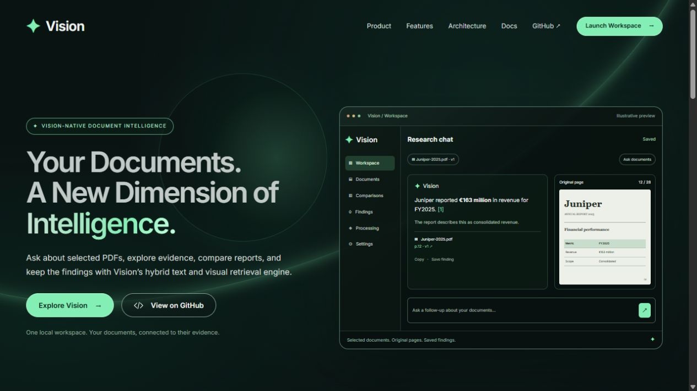
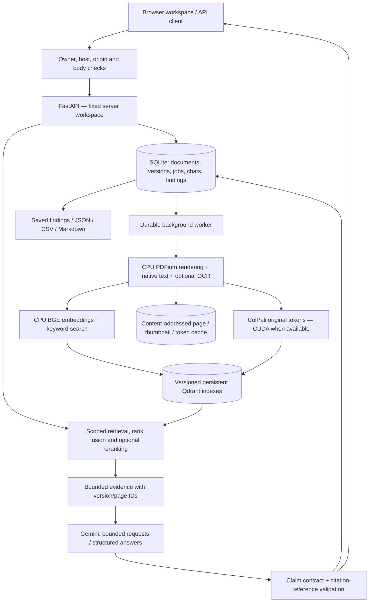

<div align="center">

# Vision — Document Intelligence

### Ask about selected PDFs. Inspect the evidence. Keep the findings.

[](https://huggingface.co/vidore/colpali-v1.3)
[](#architecture)
[](#api)
[](Docs/Validation.md#recorded-checks)
[](#status-and-limits)

Vision is a local document workspace with hybrid text and visual retrieval,
version-specific citations, persistent chats and evidence-linked comparisons.
It combines native PDF text, optional OCR and ColPali page embeddings, then uses
Gemini to generate answers from retrieved evidence.

</div>

> Updated 9 November 2026 for the implemented phases and workspace redesign.
> The verified profile is one local application process and one owner.
> Production and shared-deployment release gates remain incomplete.
> See the [documentation index](Docs/README.md#current-status) and
> [feature matrix](Docs/Validation.md#feature-status) for scope and progress.

**Upgrade history:** [From the original prototype to the current workspace](Docs/Upgrade%20history.md)
explains every phase, implementation changes, old/new screenshots and measured results.



The root page introduces the project. **Explore Vision** opens the separate
`/workspace` application with saved chats, documents, comparisons and findings.

## What you can do

- **Keep a persistent PDF library:** immutable versions, replacements, deletion,
  background jobs, progress, retry and cancellation.
- **Ask within an explicit source set:** select up to six documents and submit
  questions when they become searchable. An empty selection blocks sending.
- **Find pages locally:** retrieve evidence without a generation-provider call;
  local embedding models are still required.
- **Inspect cited originals:** version-specific page previews, navigation, zoom
  and original PDF access in a desktop drawer or mobile sheet.
- **Compare reports or retained versions:** select two to four versions and one
  to eight fields; keep citations, units, currency, period, scope and explicit
  missing evidence in the resulting table.
- **Save and export findings:** retain useful answers and comparisons, record
  review status, and export JSON, CSV or Markdown with source references.
- **Manage data:** clear history or regenerable caches, perform a confirmed
  library reset, or create an authenticated offline backup.

Answers stream as provisional claim text; final validated citations are
authoritative. Stop requests cancellation at a safe boundary. Chats and submitted
turns persist on the server; unsent drafts use browser-tab session storage.
Access tokens are not stored there.

## Quick start

The named verified profile is **Windows, Python 3.14 and an NVIDIA RTX 4050 Laptop
GPU**. The package declares Python 3.10–3.14 support; other platforms and hardware
need separate validation. Docker is not required for default local storage.

### 1. Install

With Python and `uv` available, in PowerShell:

```powershell
git clone https://github.com/saubhagya7dev/Vision---Document-Intelligence-RAG-pipeline.git
cd Vision---Document-Intelligence-RAG-pipeline
uv sync --frozen --extra dev
```

For the measured Windows/Python 3.14 CUDA profile, apply the separate overlay:

```powershell
uv pip install --python .venv/Scripts/python.exe -r requirements/cuda-windows-py314.txt
.\.venv\Scripts\python.exe scripts/check_gpu.py
```

See [GPU setup](Docs/Usage.md#cuda-and-model-setup). PDF rendering runs on the CPU; compatible
CUDA accelerates ColPali embeddings. `EMBEDDING_DEVICE=auto` selects CUDA, then
MPS, then CPU when available. CPU inference is supported by the code but is not
an equivalent performance profile.

### 2. Configure

Create `.env` only if it does not already exist:

```powershell
if (!(Test-Path .env)) { Copy-Item .env.example .env }
```

Supply your private `GOOGLE_API_KEY` and a `GENERATION_MODEL_NAME` available to
your account. See [.env.example](.env.example) for all settings. Do not commit
`.env` or real credentials. Model files download on first use.

Optional Tesseract OCR uses `TESSERACT_EXECUTABLE`; missing OCR records a warning
and uses the visual fallback. See [hybrid ingestion setup](Docs/Architecture.md#extraction-and-routing).

### 3. Start

```powershell
.\.venv\Scripts\python.exe -m vision_rag.api.main
```

Open **[http://127.0.0.1:8000](http://127.0.0.1:8000)** and choose **Explore Vision**
to enter the workspace. On macOS/Linux, the
environment executable is `.venv/bin/python`; those profiles are not covered by
the named Windows verification.

After installing the CUDA overlay, use the environment's Python directly or
`uv run --no-sync`. Regular syncing may restore the default Torch build and
require reapplying the overlay. Do not sync a running Windows environment.

If port 8000 is occupied, use the existing server or another `BIND_PORT`.
Simultaneous servers must use different `DATA_DIR` values: each library has one
owning process.

### 4. Use the workspace

1. Start a chat and upload a PDF beside the composer, or select library documents.
   The [fictional demo PDFs](examples/phase7-demo) are available to try.
2. Wait for the selected documents to become searchable. New search snapshots
   are prepared automatically; advanced controls are under Processing & search.
3. Ask a question, or choose Find pages for retrieval without generation.
4. Open citations to inspect original pages. Save useful answers or use Compare
   reports for a cited table across selected versions.

See the [workspace guide](Docs/Usage.md#chat-and-evidence) for selection, draft
recovery, cancellation and mobile behavior.

## Architecture



Every page retains native extraction and processing metadata. Layout and text
quality determine where visual processing or optional OCR is needed. This is a
hybrid pipeline, not a promise to bypass text extraction or OCR on every page.

Text retrieval combines pinned BGE embeddings with keyword search. Visual
retrieval supports original **token-by-128-dimension matrices** and exact MaxSim,
rather than only one vector per page. Pooled representations remain for the
historical baseline; coarse candidates can be reranked against original tokens.
Index profiles isolate incompatible representations and support activation and
rollback. Learned starting-tier routing is experimental and disabled by default.

Citation-reference validation checks that IDs belong to supplied evidence. It
does not independently prove claim correctness or semantic support. Document
instructions are treated as untrusted data; prompt injection is not declared solved.

## Configuration and storage

| Setting | Default | Purpose |
| --- | --- | --- |
| `DATA_DIR` | `data` | Library metadata, originals, indexes and artifacts |
| `QDRANT_MODE` | `local` | Persistent embedded Qdrant; no Docker required |
| `EMBEDDING_DEVICE` | `auto` | Accelerator selection |
| `INGESTION_BATCH_SIZE` | `2` | Bounded visual batch; CUDA profile uses 1 |
| `RENDER_DPI` | `300` | Page render resolution |
| `OCR_ENABLED` | `true` | Optional local OCR adapter |
| `MAX_UPLOAD_MB` | `100` | Per-PDF upload limit |
| `MAX_DOCUMENT_PAGES` | `1000` | Document page limit |
| `MODEL_WARMUP` | `false` | Load models during startup when enabled |
| `PHASE4_ENABLED` | `true` | Hybrid retrieval and versioned search indexes |
| `BIND_HOST` / `BIND_PORT` | `127.0.0.1` / `8000` | Local server address |
| `ACCESS_TOKEN` | unset | Optional owner sign-in / bearer access |
| `CORS_ORIGINS` | `[]` | Explicit allowed cross-origin clients |

`QDRANT_MODE=memory` is disposable. Server mode is optional and is not the verified
local profile. Legacy `QDRANT_IN_MEMORY` no longer selects storage. The compose
file is a separate localhost-bound Qdrant experiment, not a production deployment.

Documents and eligible indexes persist across restarts. Replacement creates a
new version; a failed replacement keeps previous evidence active. Deletion hides
a document from retrieval before retryable physical cleanup. Historical versions
without retained eligible indexes may show missing evidence.

### Owner access and data controls

Local use is anonymous by default and binds to loopback. Set a private random
`ACCESS_TOKEN` of at least 32 characters to require owner sign-in. The browser
receives a revocable HttpOnly, SameSite Strict cookie; API clients can use
`Authorization: Bearer ...`. Tokens must never appear in URLs.

When enabled, authorization covers search, originals, previews, chat events,
findings, exports and OpenAPI. Static assets, `/health` and session entry points
remain public. This is one owner in a fixed workspace, not multi-user RBAC.
Network use requires additional TLS/proxy configuration and verification; no
supported shared deployment profile is claimed.

Settings & data separates history clearing, regenerable cache clearing and
confirmed library reset. See [data controls](Docs/Usage.md#data-controls).

### Backup and recovery

Stop the app before creating or restoring a backup:

```powershell
.\.venv\Scripts\python.exe -m vision_rag.backup keygen backups/library.key
.\.venv\Scripts\python.exe -m vision_rag.backup create data backups/library.zip --key-file backups/library.key
.\.venv\Scripts\python.exe -m vision_rag.backup restore backups/library.zip restored-data --key-file backups/library.key
```

Backup requires an idle persistent local library. Restore requires a new target
and validates archive authentication, paths, hashes, SQLite, originals and vector
counts. Keep the key separately: authentication is **not encryption**. Archives
contain library content; configuration, model downloads and regenerable page
caches are excluded. See [recovery details](Docs/Usage.md#backup-and-restore).

## API

Use `/openapi.json` for current schemas, with owner authorization when enabled.
Strict CSP may block interactive Swagger/ReDoc assets; `/docs` is not the
recommended setup check. `GET /health` returns `{"status":"ok"}` for liveness,
not model/provider readiness.

| Endpoint | Behavior |
| --- | --- |
| `POST /api/v1/ingest` | Multipart PDF; HTTP 202 with a durable job |
| `GET /api/v1/jobs/{id}` | Progress and errors; retry/cancel actions also available |
| `GET /api/v1/documents` | Library documents |
| `POST /api/v1/documents/{id}/versions` | Queue a replacement version |
| `DELETE /api/v1/documents/{reference}` | HTTP 202; hide immediately, queue cleanup |
| `GET /api/v1/versions/{id}/file` | Retained original PDF |
| `GET /api/v1/versions/{id}/pages/{number}` | Version-specific page preview |
| `POST /api/v1/query` | Scoped answer or provider-free evidence retrieval |
| `GET /api/v1/workspace/readiness` | Search eligibility without model loading |
| `POST /api/v1/conversations` | Create a persisted chat with explicit documents |
| `POST /api/v1/conversations/{id}/messages` | HTTP 202; start a persisted answer turn |
| `GET /api/v1/messages/{id}/events` | Ordered, replayable SSE events |
| `POST /api/v1/comparisons` | Create a cited comparison finding |
| `GET /api/v1/findings/{id}/export?format=json` | JSON, CSV or Markdown (`md`) export |
| `GET /api/v1/indexes` | Retrieval builds and activation state |

Example in **PowerShell 7**, against a running local server:

```powershell
$base = 'http://127.0.0.1:8000'
$headers = @{}
if ($env:VISION_OWNER_TOKEN) {
    $headers.Authorization = "Bearer $env:VISION_OWNER_TOKEN"
}
$job = Invoke-RestMethod -Method Post -Uri "$base/api/v1/ingest" -Headers $headers -Form @{
    file = Get-Item '.\examples\phase7-demo\Juniper-2025.pdf'
}
Invoke-RestMethod "$base/api/v1/jobs/$($job.id)" -Headers $headers
```

Upload returns a job, not a synchronous success message. Fields include `id`,
`document_id`, `version_id`, `state`, `pages_done`, `total_pages`, `error` and
timestamps. Poll until ready/failed/cancelled and wait for search readiness.
Then query that document without a generation-provider call:

```powershell
$body = @{
    query = 'What revenue is reported?'
    document_ids = @($job.document_id)
    top_k = 3
    evidence_only = $true
} | ConvertTo-Json
Invoke-RestMethod -Method Post -Uri "$base/api/v1/query" -Headers $headers `
    -ContentType 'application/json' -Body $body
```

Set `evidence_only` to `$false` to request a generated answer. Sources carry
version IDs and page references; retrieval scores are not confidence probabilities.
The browser uses persisted turns and SSE rather than the synchronous `/query` call.

If a streamed answer fails, **Retry without streaming** creates an explicit new
turn with the original question and scope. The API option is `stream_answer: false`
on a conversation-message request. It still validates the final claims/citations;
it does not bypass provider quotas or automatically repeat a paid request.

## Verification and measured limits

The [9 November luminous interface record](Docs/evidence/luminous-verification.json)
reports **138 Python tests and seven frontend tests passed**, plus static and
desktop/mobile checks for the new landing-to-workspace experience.

The [8 November workspace record](Docs/Validation.md#recorded-checks) reports **136 Python
tests and four frontend tests passed**, plus lint, format, strict typing,
compilation and desktop/mobile browser checks. Browser fixtures use fictional
PDFs and simulated inference, separately from real model/provider measurements.

The [Phase 7 benchmark](Docs/Validation.md#retrieval-results) records the RTX 4050 Laptop:

| Small retrieval smoke set | Pooled recall@3 | Hybrid Borda recall@3 | Exact visual recall@3 |
| --- | ---: | ---: | ---: |
| Public: 8 questions / 20 selected pages | 93.75% | 100% | 100% |
| Fictional: 16 questions / 18 candidate pages | 75% | 81.25% | 100% |

The public set is a pinned, **gold-enriched** ViDoRe V3 subset, not official
full-corpus scores. Hybrid misses three internal scan questions that exact visual
retrieval finds. These results do not establish broad answer accuracy or a router
cost advantage.

Real provider checks include a streamed cited answer and fictional comparisons.
Remaining Phase 7 requests stopped on HTTP 503; checkpointed scripts can resume.
Usage is recorded where available; dollar cost is not established. Independent
semantic support, representative abstention quality, human verification time and
RTX 3050 hardware remain unmeasured.

### Run checks

```powershell
.\.venv\Scripts\python.exe -m pytest -q
node --test tests/frontend_selection.test.mjs tests/frontend_landing.test.mjs
.\.venv\Scripts\python.exe -m ruff check src scripts tests
.\.venv\Scripts\python.exe -m ruff format --check src scripts tests
.\.venv\Scripts\python.exe -m mypy src
```

Routine tests require no model downloads or paid API calls. Optional benchmarks
need the evaluation extra (`uv sync --frozen --extra dev --extra evaluation`),
followed by reapplying the CUDA overlay for the measured profile.
See [evaluation commands](Docs/Validation.md#run-checks).

## Status and limits

- Local document/chat/comparison workflows are implemented. Production release
  approval remains incomplete; passing tests alone does not establish readiness.
- [Release-gate records](Docs/evidence/phase7-release-gates.json) apply to their recorded
  source revision. Later source changes make them stale; the checker rejects
  stale fingerprints and unverified gates.
- A wheel and isolated packaged API/static/session smoke passed at Phase 7.
  Later changes need a fresh build and verification before distribution.
- A pinned, non-root Docker CPU recipe exists; container runtime and shared TLS
  deployment were not verified. It binds container loopback; ordinary port
  forwarding alone is not a supported deployment procedure.
- The [recorded dependency audit](Docs/evidence/phase7-dependencies.json) retains an
  Accelerate checkpoint advisory and excludes CUDA wheels. Use trusted pinned
  model files; no clean security audit is claimed.
- Calculated metrics, region questions, automatic version diffs and similarity
  maps are outside the completed comparison workflow.

## Repository map

```text
src/vision_rag/
  api/             HTTP contracts, owner sessions, chats and findings
  analysis/        Evidence-linked comparison
  ingest/          Rendering, native extraction, OCR and page routing
  models/          ColPali, CPU text encoder and Gemini adapters
  retrieval/       Index lifecycle, search, scoring and experimental router
  storage/         SQLite metadata, documents, jobs, chats and findings
  generate/        Grounding contracts, events and synthesis
  vector_stores/   Pooled and hybrid Qdrant adapters
  static/          Chat-first HTML/CSS/JavaScript workspace
  backup.py        Offline authenticated backup/restore
  config.py        Environment-backed settings
  telemetry.py     Stage timing and credential-safe logging
tests/             Regression tests and disposable browser fixtures
scripts/           GPU, retrieval, provider, packaging and release checks
examples/phase7-demo/  Fictional CC0 PDFs and gold task manifest
Docs/              Six maintained guides; assets/ and evidence/
data/              Ignored runtime library; never commit user documents
```

## Project documentation

- [Documentation index and current status](Docs/README.md)
- [Upgrade history — old vs new, pictures and implementation](Docs/Upgrade%20history.md)
- [Usage — setup, workspace, data controls and recovery](Docs/Usage.md)
- [Architecture and implementation decisions](Docs/Architecture.md)
- [Validation, benchmarks and release limits](Docs/Validation.md)
- [Merged research and deferred ideas](Docs/Research.md)


Contributions should explain the change and its verification. Keep real documents,
credentials, runtime data and model caches out of commits. Separate model/provider
evaluations from routine tests. Interfaces in `core/` support adapters; replacing
a model or store also requires compatible profiles, indexing, scope and validation.
