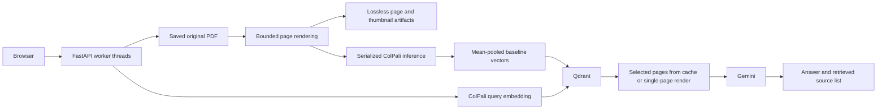

# Vision — document intelligence

Vision answers questions about PDF pages using local ColPali embeddings, Qdrant retrieval, and Gemini generation. FastAPI serves a plain HTML/CSS/JavaScript interface.

**Upgrade status: Phase 1 implemented. Phases 2–7 have not started.** The current retrieval representation is still mean-pooled ColPali vectors, not late-interaction MaxSim. Hybrid text retrieval and validated claim-level citations are planned.

## What Phase 1 changes

- Counts PDF pages without rendering them.
- Renders only the requested page for previews and answer context.
- Caches lossless page images and thumbnails under content hashes.
- Processes ingestion in bounded batches; serializes model inference.
- Detects CPU/CUDA/MPS, supports explicit precision and device selection, and retries multi-page accelerator memory failures one item at a time.
- Separates lightweight library/storage initialization from heavy model initialization.
- Offers startup model loading, readiness state, and shutdown cleanup.
- Runs blocking routes in FastAPI's thread pool so a query does not block the event loop.
- Emits stage timings with request trace IDs and no question/document content in timing records.
- Fixes Qdrant point statistics and rejects mismatched vector batches.
- Adds basic request/upload limits, filename containment, duplicate-name protection, and best-effort cleanup after failed ingestion.

See [Phase 1 results and limits](Docs/Phase%201%20results.md), [raw benchmark](Docs/phase1-benchmark.json), and [phase checklist](Docs/Implementation%20plan.md).

## Architecture today



A source list identifies retrieved pages; it does not prove that each generated claim is supported.

## Run locally on Windows

Use Python 3.10–3.14 and run from the repository root. The current environment was tested with Python 3.14.9; a clean installation on every supported Python version has not been tested.

```powershell
uv sync --extra dev --frozen
Copy-Item .env.example .env
# Edit .env: add GOOGLE_API_KEY and an available GENERATION_MODEL_NAME.
.\.venv\Scripts\python.exe -m vision_rag.api.main
```

If you already have a configured environment and .env, keep them; start with the final command. The server binds to [localhost:8000](http://localhost:8000). API documentation is at [localhost:8000/docs](http://localhost:8000/docs).

The first ingestion/query loads the embedding model unless MODEL_WARMUP=true. Loading can download model weights and can require model access approval. No weights or paid provider calls are needed for the routine tests. Model and provider access must be verified separately for a real answer.

### GPU diagnostics and profiles

```powershell
.\.venv\Scripts\python.exe -c "import json; from vision_rag.runtime import device_diagnostics; print(json.dumps(device_diagnostics(), indent=2))"
```

Or open [diagnostics](http://localhost:8000/api/v1/diagnostics) while the app is running.

The inspected machine has an RTX 4050 Laptop GPU with 6141 MiB VRAM, but its installed PyTorch 2.13.0 has no CUDA support. Auto mode therefore uses CPU. Use the [official PyTorch installer selector](https://pytorch.org/get-started/locally/) for a build compatible with your Python, operating system, driver, and GPU. No CUDA package installation or GPU inference was performed in Phase 1. A subsequent environment sync can replace a manually installed Torch build; recheck diagnostics after changing dependencies.

Suggested starting settings, **not hardware performance guarantees**:

| Profile | Device | Precision | Batch |
| --- | --- | --- | --- |
| CPU fallback | cpu | float32 | 1 |
| Constrained accelerator | auto | auto | 1 |
| Default | auto | auto | 2 |
| Larger accelerator trial | cuda | auto | 4 |

Set EMBEDDING_DEVICE, EMBEDDING_PRECISION and INGESTION_BATCH_SIZE accordingly. Keep RENDER_DPI=300 initially. The model itself must fit in memory: reducing batches cannot make oversized model weights fit. Unsupported explicit devices fail rather than silently switching. A multi-item memory failure retries every item individually; a single-item failure reports a smaller-model/CPU action. Selecting another model name does not establish compatibility with the current ColPali adapter.

MODEL_WARMUP=true moves component loading into startup; startup fails if initialization fails. With false, library and health endpoints work before models load. GET /api/v1/ready returns 503 until components are loaded, then 200. This indicates local initialization, not verified provider connectivity or answer quality.

## Configuration

.env.example lists defaults and limits. In particular:

| Setting | Default | Purpose |
| --- | --- | --- |
| DATA_DIR | data | Original PDFs and cached artifacts |
| RENDER_DPI | 300 | Full page rendition resolution |
| INGESTION_BATCH_SIZE | 2 | Maximum page and encoder batch |
| EMBEDDING_DEVICE | auto | auto, cpu, cuda, mps |
| EMBEDDING_PRECISION | auto | auto, float32, float16, bfloat16 |
| MODEL_WARMUP | false | Initialize components before serving |
| MAX_UPLOAD_MB | 100 | Bytes copied from a parsed upload |
| MAX_DOCUMENT_PAGES | 1000 | Validated PDF page limit |
| MAX_RENDER_PIXELS | 40000000 | Reject oversized page rasters |
| QDRANT_IN_MEMORY | true | Existing disposable local index mode |

Auto precision uses float32 on CPU and float16 on CUDA/MPS. Explicit bfloat16 requires supported CUDA hardware.

In-memory Qdrant loses its index on restart. For the existing server mode, run docker compose up -d and set QDRANT_IN_MEMORY=false. Durable metadata, ingestion recovery, versioning, and storage reconciliation belong to Phase 2. Run one application worker in Phase 1; multiple worker processes duplicate models and invalidate the in-memory storage assumptions.

Artifacts use data/artifacts/<content-hash>/<dpi>-v1-<kind>-<page>.png. They preserve full-page detail; thumbnails are at most 240 × 320. Corrupt cached images regenerate from originals. Cache writes add work on first ingestion; disk retention and orphan cleanup are not implemented. With the server stopped, artifacts may be cleared and will regenerate. Keep originals and index data.

## API examples

```powershell
curl.exe -F "file=@report.pdf" http://localhost:8000/api/v1/ingest
$question = @{ query = 'What is the revenue?'; top_k = 3 } | ConvertTo-Json
Invoke-RestMethod -Uri 'http://localhost:8000/api/v1/query' -Method Post -ContentType 'application/json' -Body $question
```

Successful ingestion returns status and message. Queries return:

```json
{
  "answer": "Generated answer text",
  "sources": [{"score": 0.9, "source": "absolute/path/report.pdf", "page": 1}]
}
```

The score above illustrates the contract; it is not a measured relevance threshold.

| Method | Route | Purpose |
| --- | --- | --- |
| GET | /health | Lightweight process liveness |
| GET | /api/v1/ready | Component initialization state |
| GET | /api/v1/diagnostics | Hardware/configuration/model diagnostics |
| GET | /api/v1/documents | Original PDF inventory and direct page counts |
| POST | /api/v1/ingest | Synchronous bounded ingestion |
| POST | /api/v1/query | Answer from selected retrieved page images |
| GET | /api/v1/documents/{filename}/pages/{page} | Single-page JPEG |
| GET | Same route with ?thumbnail=true | Cached thumbnail |
| DELETE | /api/v1/documents/{filename} | Delete matching vectors and original |
| GET | /api/v1/stats | Point count and storage status |

Responses include X-Trace-ID. Timing logs distinguish model imports/loading, upload handling, PDF inspection, rendering/cache I/O, inference queue wait, inference, embedding, upsert, query embedding, retrieval, evidence preparation, provider generation, and HTTP duration. Native text extraction, reranking, and first-token timing are not reported because those stages do not exist yet. Upload timing starts after multipart parsing; it is not network transfer time.

Same-name uploads return 409 instead of overwriting existing evidence. Use the delete action before replacement for now; proper version semantics arrive in Phase 2. Basic limits do not replace ingress body limits, authentication, or authorization.

## Verify and benchmark

```powershell
.\.venv\Scripts\python.exe -m pytest -q
.\.venv\Scripts\python.exe -m ruff check src tests scripts
.\.venv\Scripts\python.exe -m mypy src
.\.venv\Scripts\python.exe scripts/benchmark_phase1.py --output Docs/phase1-benchmark.json
```

The benchmark generates a synthetic eight-page PDF in temporary storage and launches a fresh process for each case. Optional psutil provides process peak-memory readings. It does not download models, call a provider, or measure retrieval/answer quality. The report includes per-sample values, versions, hardware, and measurement limits.

In the restricted Codex Windows sandbox, asyncio's socket-pair setup stalled before API requests reached the app; API tests were verified outside that sandbox.

## Current limits

This remains a local prototype. Real GPU inference, end-to-end model/provider latency, retrieval quality, and visual label fidelity across real documents remain unverified. There is no backend conversation persistence, hybrid index, claim-level citation validator, durable ingestion queue, or shared-deployment access boundary. Ingestion uses random page IDs and best-effort cleanup; crash consistency and cross-store transactions are not guaranteed. The document list inventories files, not authoritative index readiness.

The original generation-model default has not been validated against the provider. Configure a currently available model in .env. The frontend still contains illustrative analytics and browser-only conversation state; their replacement is planned for Phase 5. Shared deployment, full security hardening, packaging verification, and release evaluation remain Phase 7 work.
